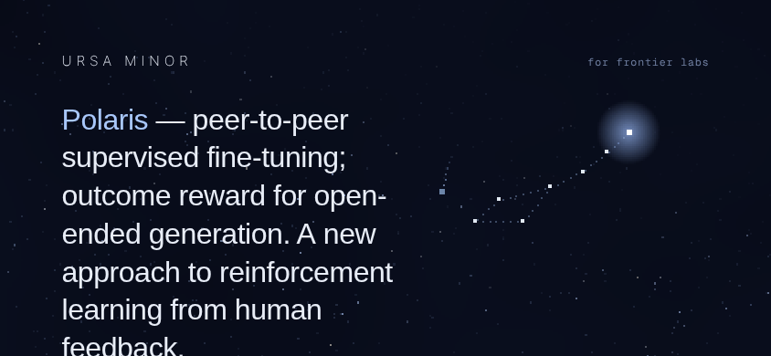
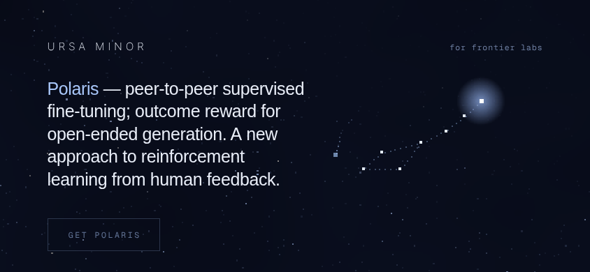
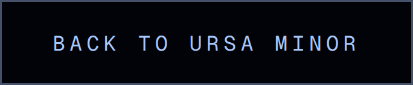
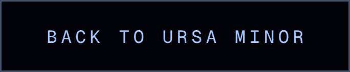
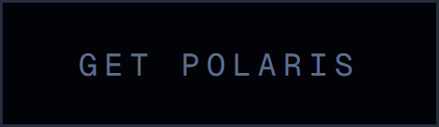
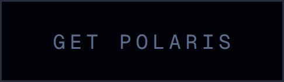
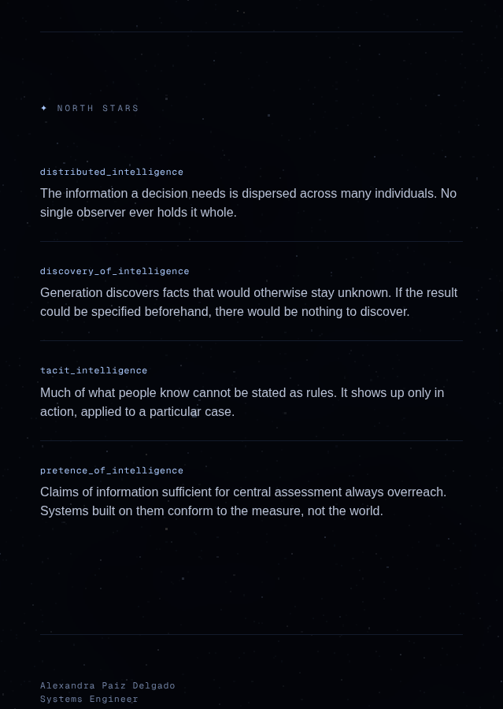
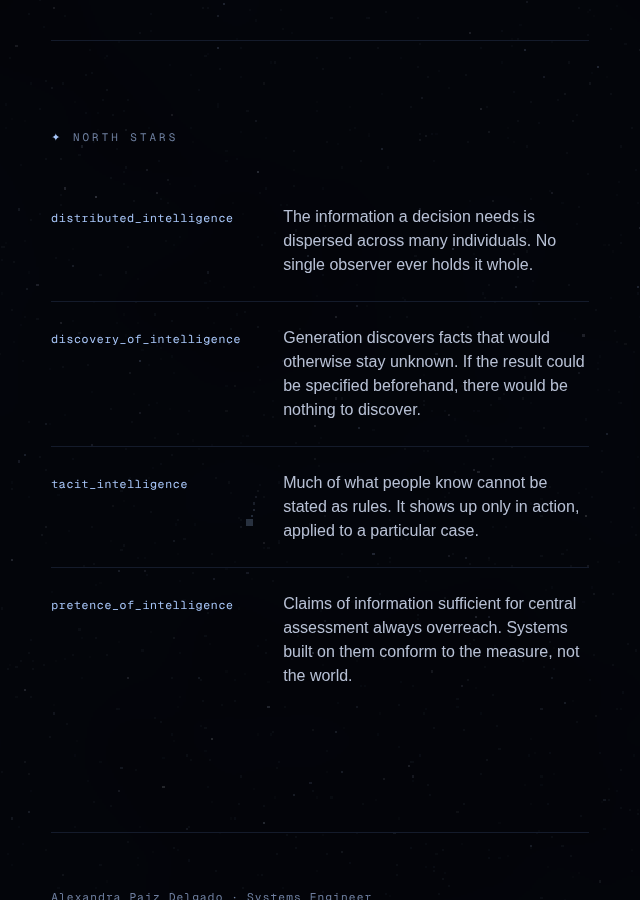

# Frontend visual review — 2026-10-12

Run under `prompts/frontend-agent.md`. Surface: the Ursa Minor site
(`ursa-minor/`, Next.js 16). `ursa-major/` is a CLI and has no frontend of its
own, so it stays out of scope for a visual run.

Everything below was rendered in headless Chromium with WebGL running through
SwiftShader, so the starfield shader and the constellation canvas are the real
thing rather than the no-WebGL fallback. Seventy-six screenshots before and
seventy-six after, at iPhone 390x844, iPad 820x1180 and desktop 1440x900, plus
landscape phone 844x390, desktop 1920x1080, four narrow widths and a
reduced-motion pass on each page. Every one of them was read before anything
was called fixed or fine.

Capture note, carried from 2026-10-01: these are viewport screenshots at scroll
positions, never `fullPage`. The sky is `position: fixed`, and `fullPage`
flattens everything below the first viewport height.

Harness: [`shots.mjs`](shots.mjs). Every number in this record comes from a
probe committed next to it, each runnable against `next start -p 3100`:
[`probe-landscape.mjs`](probe-landscape.mjs),
[`probe-herofit.mjs`](probe-herofit.mjs), [`probe-header.mjs`](probe-header.mjs),
[`probe-hit.mjs`](probe-hit.mjs), [`probe-ink2.mjs`](probe-ink2.mjs),
[`probe-contrast.mjs`](probe-contrast.mjs),
[`probe-measure.mjs`](probe-measure.mjs), [`probe-band.mjs`](probe-band.mjs),
and under `benchmark/`, [`bench.mjs`](benchmark/bench.mjs),
[`probe-focus2.mjs`](benchmark/probe-focus2.mjs) and
[`probe-tap.mjs`](benchmark/probe-tap.mjs).

## Branch survey (L-E10), and a draft resolved

This seat had one open pull request, #141, `fe/2026-10-08-visual-review`, a
draft. Its run found three bugs, fixed them, benchmarked four sites, landed two
refinements and committed 76 screenshots, and then ended before writing any of
it into the description or readying it. Under the charter's "ready it, or hand
it over in writing" amendment, the next run of the seat inherits that. This
branch starts by merging #141 whole, so none of its work is rebuilt and none of
it is lost. **The before set in this record is therefore the state of the site
with #141 applied**, which is the honest baseline for anything shipped today.

#141 should be closed when this merges.

## What I found and fixed

### 1. In landscape the hero ran off the bottom of the screen

Every phone-landscape size cut the hero sentence mid-line at the fold and put
the only control 90 to 100px below it, with no scroll cue, because the cue is
portrait-only by design. Measured with `probe-landscape.mjs`, bottom of the
copy and bottom of the control against the viewport height:

| viewport | lines | copy ends | control ends | verdict |
|---|---|---|---|---|
| 667x375 | 7 | 358.3 | 445.6 | control 70.6 below the fold |
| 740x360 | 7 | 366.7 | 454.0 | **copy clipped by 6.7** |
| 844x390 | 7 | 402.6 | 489.9 | **copy clipped by 12.6** |
| 896x414 | 7 | 420.5 | 507.8 | **copy clipped by 6.5** |
| 932x430 | 7 | 433.1 | 520.4 | **copy clipped by 3.1** |
| 1024x600 and up | 5-7 | fits | fits | fits |

The cause is the type scale. `clamp(1.7rem, 3.8vw, 2.7rem)` answers only to the
width, and its 1.7rem floor is right when the viewport is tall and is exactly
what breaks it when the viewport is short: the floor holds the type up while
the fold comes down. 2026-10-08 had capped the copy at `46vw` in landscape to
keep it clear of the dipper, which was right, and which also took the sentence
to seven lines.

The fix gives landscape a height as well as a width:
`landscape:text-[min(3.8vw,6.4vh,2.7rem)]`. 6.4vh is measured rather than
chosen. `probe-herofit.mjs` sweeps the type from 16 to 34px at each size and
reports the largest that keeps the whole sentence above the fold: 26px at
844x390, 24 at 740x360, 29 at 932x430, which is 6.6 to 6.7vh at each, so 6.4
clears every one of them with a margin. Nothing that already fitted moves,
because `min()` picks 3.8vw or the 2.7rem ceiling at every landscape size from
1024x768 up; 1024x600 changes by half a pixel.

After: every landscape size shows the whole sentence, and all but the shortest
show the control too.

| viewport | copy ends | control ends |
|---|---|---|
| 667x375 | 329.1 | 416.4 (top edge of the border visible at the fold) |
| 740x360 | 260.6 | 347.8 |
| 844x390 | 273.0 | 360.3 |
| 896x414 | 283.0 | 370.3 |
| 932x430 | 289.6 | 376.9 |

| before (844x390) | after |
|---|---|
|  |  |

The whole landscape range after the fix, including sizes the charter set does
not cover: [667x375](landscape/after__home-hero__landscape-667x375.png),
[740x360](landscape/after__home-hero__landscape-740x360.png),
[896x414](landscape/after__home-hero__landscape-896x414.png),
[932x430](landscape/after__home-hero__landscape-932x430.png),
[1024x600](landscape/after__home-hero__landscape-1024x600.png).

The 404 was checked at the same sizes and needs nothing: its headline is one
short line, and both it and the back link sit above the fold from 667x375 up.

### 2. The 404's word-mark was a 24px tap target

`probe-contrast.mjs` reports hit sizes along with contrast. The word-mark link
on the 404, which is that page's "go home" control and its first tab stop,
renders 134.5 x 24 at every width from 320 to 1440. 24px is well under the 44px
minimum, so on a phone it was the hardest thing on the site to hit while being
one of only two things to hit.

`probe-header.mjs` says the header has the room: 56px of padding above the mark,
32px below, and at 320, where the tag wraps under the mark, 4px between the two.
The hit area is taken as an `::after` overlay rather than as padding, because
padding would grow the link's own box and both the focus ring and the hover
hairline are drawn from that box and were tuned against it on 2026-10-08. 16px
up and 4px down takes 24 to exactly 44 without moving a pixel of either, and the
4px stops at the tag's top edge rather than covering inert text.

Verified with `probe-hit.mjs`, which walks the mark's centre line in half-pixel
steps and asks `elementFromPoint` what is there:

| width | link box | hit height | covers the tag |
|---|---|---|---|
| 320x700 | 134.5x24.0 at y 56 | 44 | no |
| 390x844 | 134.5x24.0 at y 56 | 44 | no |
| 820x1180 | 134.5x24.0 at y 56 | 44 | no |
| 1440x900 | 134.5x24.0 at y 56 | 44 | no |

The box is unchanged at every width, which is the point. The focus ring is
pixel-identical before and after:

| before | after |
|---|---|
|  |  |

### What I checked and did not change

- **Contrast.** `probe-contrast.mjs` samples the sky actually rendered behind
  each text run rather than assuming a flat background. Every run clears AA:
  the dim mono at 4.82 to 5.14, the body at 11.29, the keys at 11.99, the hero
  at 16.4 to 17.6. The disabled control reads 4.04, and WCAG 1.4.3 exempts
  inactive components. Two separator dots read 3.6 in one pass; that is the
  sampler landing on a bright star beside a 3px glyph, not a real finding, and
  the dots are the same colour as the text at 4.85 on either side of them.
- **The hero mark.** Untouched, as the dispatch requires. Both fixes are
  typographic and neither moves the constellation.
- **Reduced motion.** Checked on both pages at three viewports. The pulse, the
  shooting star, the cue animation and smooth scrolling are all off, and the
  scroll darkening still works, which is the right split.

## Benchmark

Four best-in-class product sites, measured on the rendered page rather than
read out of a stylesheet. `bench.mjs` finds the most prominent transitioned
control above the fold and reads it at rest, on hover and held down.

| site | control | duration | curve | hover | press |
|---|---|---|---|---|---|
| Linear | Sign up | 160ms | cubic-bezier(0.25, 0.46, 0.45, 0.94) | background only | **scale 0.9703** |
| Vercel | Sign Up | 150ms | cubic-bezier(0.4, 0, 0.2, 1) | background only | none |
| Cursor | nav control | 150ms | cubic-bezier(0.4, 0, 0.2, 1) | colour only | none |
| Perplexity | Search | 150ms | cubic-bezier(0.4, 0, 0.2, 1) | colour only | none |

The consensus is the one three runs of this seat have now measured
independently: short, decelerating, colour on hover, and motion held back for
the press, where only Linear spends it and spends under 3%. Our `.cta` and
`.quiet-link` already run 160ms on Linear's own curve, which is where that came
from.

Two further things were measured and then not acted on, which is worth
recording because the measurement is the finding:

- **Focus rings.** Linear 1px at 2px offset plus a two-tone 4px halo in
  box-shadow; Vercel 2px at 4px; Cursor 2px at 2-3px; Perplexity 2px.
  Ours is 1px `--polar` at 3px offset, the thinnest of the five. Three of four
  benchmarks are at 2px, but "hairlines" is in this site's stated identity, so
  taking the ring to 2px is the owner's call and not mine. Proposal below.
- **Tap highlight.** The designed press state on `.quiet-link` exists precisely
  because touch gets no hover, so a UA tap highlight painted over it would
  double the feedback. `probe-tap.mjs` says every one of the five, including us,
  already computes `-webkit-tap-highlight-color: rgba(0, 0, 0, 0)`, ours through
  Tailwind's preflight. Nothing to do. Measuring it cost less than guessing.

## Refinement: the tracked labels were not optically centred

One refinement this run, out of the two the charter allows.

Letter-spacing is added after every glyph including the last, so a centred
uppercase label carries one trailing space its ink does not fill and lands left
of the box's centre by half of it. `probe-ink2.mjs` measures it in pixels: it
screenshots the control at 3x with the starfield hidden, finds the leftmost and
rightmost lit pixel inside the border, and compares the two gaps. Both states
are measured on the same render, with the class removed in the DOM for the
"before", so nothing is attributed to a different frame of the sky.

| control | before (left / right / skew) | after |
|---|---|---|
| GET POLARIS | 29.33 / 32.00 / **2.67px** | 30.67 / 31.00 / 0.33px |
| BACK TO URSA MINOR | 30.00 / 32.00 / **2.00px** | 31.00 / 31.00 / 0.00px |
| URSA MINOR word-mark | 2.00 / 2.00 / 0.00px | unchanged |

The word-mark already reads zero because 2026-10-08 trimmed its trailing space
so the hover hairline would stop under the final letter. This is the same defect
in the only other place it occurs, and the same remedy, applied as half the
tracking moved off the right padding and onto the left so both controls keep
their width and their left edge stays on the page's margin.

| before (3x) | after (3x) |
|---|---|
|  |  |
|  |  |

Benchmark note: none of Linear, Vercel, Cursor or Perplexity tracks a primary
control far enough for this to arise, which is why none of them corrects it.
The tracking is ours, so the correction has to be ours too.

The second refinement was left unspent on purpose. The candidates were a press
scale translated from Linear and a hover state for the north-stars rows. The
first reverses a reasoned decision 2026-10-08 recorded in the stylesheet, on no
new evidence. The second would put hover feedback on rows that are not
interactive, which teaches a visitor an affordance that is not there. Neither is
worth a diff.

## Proposals

**P1. The reading measure inverts at the `sm` boundary.** The north-stars grid
gives its key column a fixed 13rem from 640px up, so the text column is whatever
is left, and at 640 that is less than it was at 639. Measured with
`probe-measure.mjs` and `probe-band.mjs`, text column and characters per line:

| width | as shipped | if the two-column grid waited for 768 |
|---|---|---|
| 600 | 504px / 47 | 504px / 47 |
| 639 | 537px / 71 | 537px / 71 |
| **640** | **306px / 36** | 538px / 71 |
| 660 | 322px / 36 | 554px / 71 |
| 700 | 356px / 47 | 588px / 71 |
| 767 | 412px / 47 | 644px / 71 |
| 768 | 413px / 47 | 413px / 47 |
| 900 | 524px / 71 | 524px / 71 |
| 1024 and up | 376px / 47 | 376px / 47 |

36 characters is the narrowest measure on the site, narrower than the phone's,
and it arrives by making the window wider. The obvious one-class fix moves the
discontinuity rather than removing it: gating the grid on `md` trades a short
measure for a long one and puts the same jump at 768. Both states are
defensible and neither is broken, which is why this is a proposal and not a
diff. The real question is how the reading column should behave between 640 and
1024, where the page currently has no maximum width at all.

| 639 | 640 |
|---|---|
|  |  |

**P2. The focus ring against the benchmark.** Ours is the thinnest of the five
sites measured, and it sits on a sky with bright 1-2px stars in it. Linear's
answer is not thickness but separation: a dark halo between the control and the
ring, so the ring reads on any background. Translating that would keep the
hairline the identity calls for. It touches the identity, so it wants the
owner's word first.

## External sources read

- `https://linear.app/`, `https://vercel.com/`, `https://cursor.com/`,
  `https://www.perplexity.ai/` — rendered in Playwright for the benchmark and
  the focus and tap-highlight probes. Read as data: computed styles, geometry
  and state changes. Nothing on any of them addressed this run or asked
  anything of it, and no instruction was taken from any of them.
