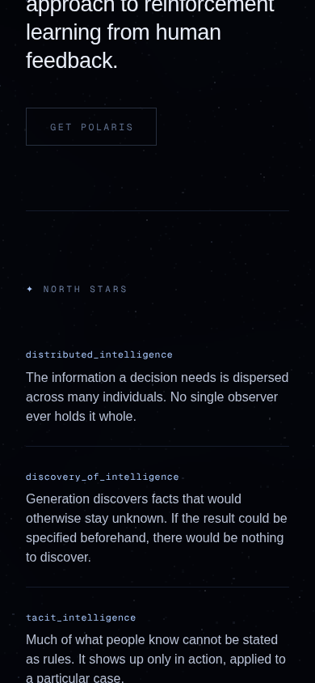
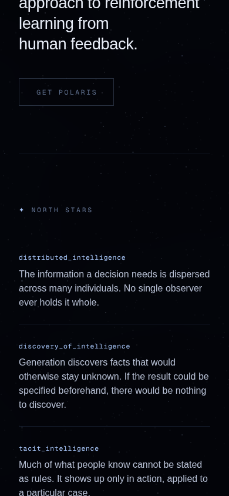
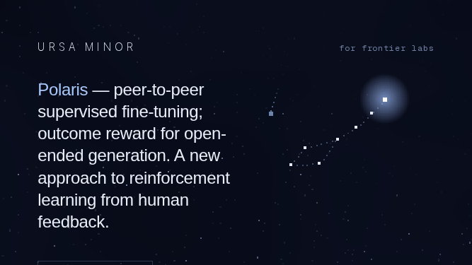
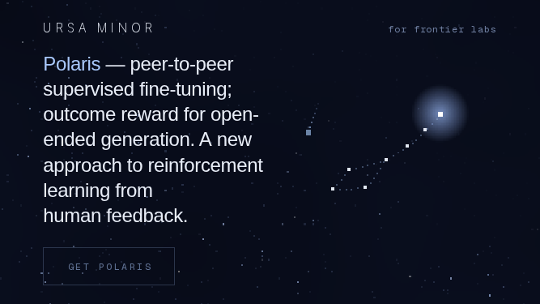
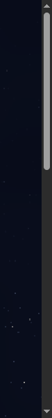
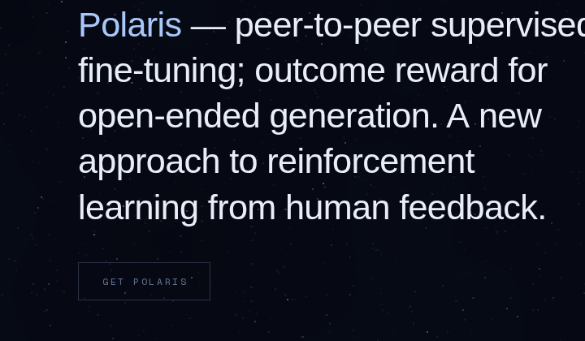
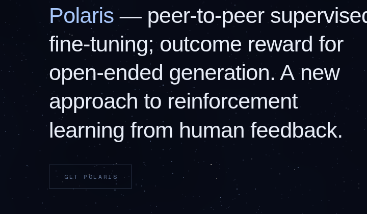
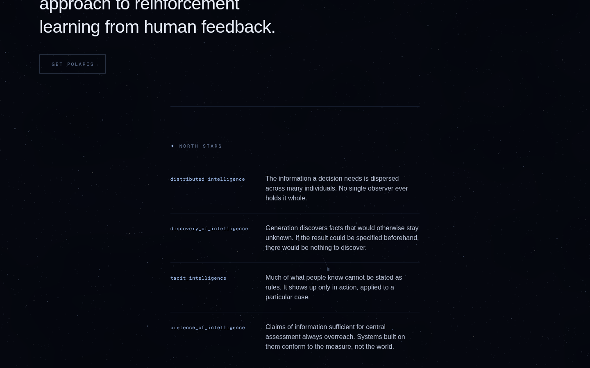
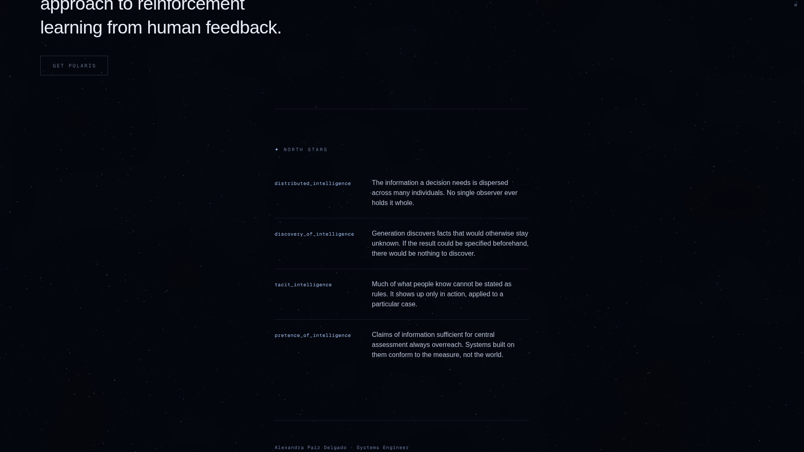

# Frontend visual review — 2026-10-15

Run under `prompts/frontend-agent.md`. Surface: the Ursa Minor site
(`ursa-minor/`, Next.js 16). `ursa-major/` is a CLI and has no frontend of its
own, so it stays out of scope for a visual run.

Everything below was rendered in headless Chromium with WebGL through
SwiftShader, so the starfield shader and the constellation canvas are the real
thing rather than the no-WebGL fallback. Seventy-six screenshots before and
seventy-six after, at iPhone 390x844, iPad 820x1180 and desktop 1440x900, plus
landscape phone 844x390, desktop 1920x1080, four narrow widths and a
reduced-motion pass on each page. Sixteen more cover eight landscape and laptop
sizes the charter set does not reach. Every one of them was read before
anything was called fixed or fine.

One thing in this record was not screenshotted in headless Chromium, because
headless Chromium cannot draw it. That is the root scrollbar, and it is
captured headed under Xvfb instead. The section says so where it arises.

Capture note, carried from 2026-10-01: these are viewport screenshots at scroll
positions, never `fullPage`. The sky is `position: fixed`, and `fullPage`
flattens everything below the first viewport height.

Harness: [`shots.mjs`](shots.mjs), [`shots-landscape.mjs`](shots-landscape.mjs)
and [`shots-smoothing.mjs`](shots-smoothing.mjs). Every number in this record
comes from a probe committed next to it, each runnable against
`next start -p 3100`: [`probe-audit.mjs`](probe-audit.mjs),
[`probe-hero.mjs`](probe-hero.mjs), [`probe-rag.mjs`](probe-rag.mjs),
[`probe-widow.mjs`](probe-widow.mjs),
[`probe-shortland.mjs`](probe-shortland.mjs),
[`probe-404land.mjs`](probe-404land.mjs), [`probe-hit.mjs`](probe-hit.mjs),
[`probe-scheme.mjs`](probe-scheme.mjs),
[`probe-scrollbar3.mjs`](probe-scrollbar3.mjs),
[`probe-smoothing.mjs`](probe-smoothing.mjs), and under `benchmark/`,
[`bench.mjs`](benchmark/bench.mjs),
[`probe-entrance.mjs`](benchmark/probe-entrance.mjs) and
[`probe-keyframes.mjs`](benchmark/probe-keyframes.mjs).

## Branch survey (L-E10)

This seat had no open pull request and no draft to inherit:

```
gh pr list --state open --limit 200 --json number,headRefName,isDraft \
  --jq '.[] | select(.headRefName | test("fe/|frontend"))'
```

returned nothing. Of the ten pull requests open across the repository, none
touches `ursa-minor/`. This branch therefore starts from `main`, which in this
one case is the honest base. #141 and the 2026-10-12 record both landed before
today.

## What the screenshots alone turned up, and what they did not

The first pass through all seventy-six found no clipped text, no overflow at
any width from 320 to 1920, no broken wrap, no contrast failure visible to the
eye, and nothing out of the grid. Three runs of this seat have been over this
site and it shows. `probe-audit.mjs` confirms the arithmetic: document overflow
is 0 at every one of the twenty widths it sweeps, on both routes.

So the four things fixed below were all found by measuring something the eye
cannot resolve, or by rendering the page somewhere headless Chromium does not
look. That is the finding behind the findings, and it is why this run spent
most of its time on probes.

## 1. The hero's last line was an orphan wherever text-balance stopped working

`text-wrap: balance` is capped in Chromium at a line limit, and the hero
sentence crosses it. `probe-rag.mjs` re-renders the same paragraph under
`balance`, `pretty` and `auto` on one load, so nothing is attributed to a
different frame of the sky, and reports the width of each rendered line:

| viewport | lines | balance | pretty | auto |
|---|---|---|---|---|
| 390x844 | 7 | last line 114px | 114px | 114px |
| 1024x768 | 7 | 163px | 163px | 163px |
| 1180x820 | 7 | 181px | 181px | 181px |
| 320x700 | 9 | 114px | 114px | 114px |
| 1366x768 | 6 | **577px** | 322px | 322px |
| 1440x900 | 5 | **577px** | 417px | 417px |
| 820x1180 | 4 | **609px** | 232px | 131px |

At four lines, five and six the balancer is doing real work and the last line
lands at 82 to 92% of the measure. At seven and above all three values return
the identical rag, which is the balancer declining to run. Where it declines,
the sentence ends on "feedback." alone: 101 to 163px of ink against a 256 to
543px box, which is 33 to 45% of the measure. On a phone at 390, the charter's
own viewport and the commonest real device, it is 35%.

The remedy is the device the sentence already uses on "A new". Binding the
final two words with a non-breaking space is one character, and
`probe-widow.mjs` measures what it does at twenty sizes:

| viewport | box | shipped, last line | with the binding | overflow |
|---|---|---|---|---|
| 320x700 | 256 | 114px / 45% | **202px / 79%** | no |
| 375x700 | 311 | 114 / 37% | **202 / 65%** | no |
| 390x844 | 326 | 114 / 35% | **202 / 62%** | no |
| 414x896 | 348 | 114 / 33% | **202 / 58%** | no |
| 667x375 | 307 | 101 / 33% | **179 / 58%** | no |
| 1024x600 | 471 | 161 / 34% | **286 / 61%** | no |
| 1024x768 | 471 | 163 / 35% | **290 / 62%** | no |
| 1180x820 | 543 | 181 / 33% | **322 / 59%** | no |
| 360, 480, 600, 740, 820, 844, 896, 932, 1280, 1366, 1440, 1920 | | | identical | no |

It fixes every size where the balancer had given up, changes nothing at any
size where the balancer still reaches, never changes the line count, and never
overflows the box at any width down to 320.

| before (390x844) | after |
|---|---|
|  |  |

## 2. In phone landscape the page's only control was sliced by the fold

`probe-hero.mjs` walks the landscape range and reports the bottom of the
control against the viewport height. Two sizes failed:

| viewport | copy ends | control ends | verdict |
|---|---|---|---|
| **667x375** | 329 | 416 | **41px below the fold** |
| **720x360** | 291 | 378 | **18px below the fold** |
| 740x360 | 261 | 348 | clears by 12 |
| 844x390 | 273 | 360 | clears by 30 |
| 896x414 | 283 | 370 | clears by 44 |
| 932x430 | 290 | 377 | clears by 53 |

667x375 is the only size in that range where the sentence runs to seven lines,
because 46vw of 667 is the narrowest box the landscape rule produces anywhere.

667x375 is iPhone SE and iPhone 8 in landscape. What a visitor saw there was
the top hairline of the control's border cut by the bottom edge of the screen,
which reads as a rendering fault rather than as an affordance, and landscape
shows no scroll cue because the cue is portrait-only by design.

The cause is the vertical budget rather than the type. The header spends 88px
of padding around a 24px line, and on a 375px screen that is 23% of everything
there is. 2026-10-12 taught the hero type to answer to the height as well as
the width, and this is the same lesson applied to the chrome. A
`short-landscape` variant, `(orientation: landscape) and (max-height: 430px)`,
takes the header from `pt-14 pb-8` to `pt-6 pb-4` and the control's own gap
from `mt-10` to `mt-6`. 430px is the ceiling because it is the tallest phone
landscape in the review set, 932x430, and above it the generous header is right
and nothing was ever close to the fold.

`probe-shortland.mjs` measures each lever separately. The header alone leaves
667x375 clearing by 7px, which is too thin to call fixed. The header and the
gap together leave it clearing by 23. After:

| viewport | control ends | clears the fold by |
|---|---|---|
| 667x375 | 352 | 23px |
| 720x360 | 314 | 46px |
| 740x360 | 284 | 76px |
| 844x390 | 310 | 80px |
| 896x414 | 334 | 80px |
| 932x430 | 350 | 80px |

Above 430px of height, every number in `probe-hero.mjs` is unchanged to the
pixel: header bottom still 111, control still ending where it did at 1024x600,
1024x768, 1180x820, 1280x720, 1280x800, 1366x768, 1440x900, 1512x982,
1680x1050 and 1920x1080. The rule reaches phone landscape and nothing else.

| before (667x375) | after |
|---|---|
|  |  |

That pair carries both fixes at once, because 667x375 is also one of the sizes
where the balancer had given up.

**What it does to the 404, which shares the header and never had the problem.**
`probe-404land.mjs` says the back link now ends at 239 to 250 against viewport
heights of 360 to 430, so it is well clear at every size, as it already was.
The footer moves up with the header, which puts the first credit line across
the fold at 360, 375 and 390 instead of below it. The page scrolled at those
sizes before the change and it scrolls after, and a cut line of text says so
more honestly than a rule sitting flush on the bottom edge. Checked, not an
accident.

**And to the 2026-10-12 hit area.** That run took the 404 word-mark from a 24px
tap target to 44px with an `::after` overlay tuned against a 112px header. The
header is now 64px in phone landscape, so `probe-hit.mjs` re-walks the centre
line in half-pixel steps and asks `elementFromPoint` what is there:

| viewport | link box | hit height | covers the tag |
|---|---|---|---|
| 320x700, 390x844, 820x1180, 1440x900 | 134.5x24.0 at y 56 | 44.0 | no |
| 667x375, 844x390, 932x430 | 134.5x24.0 at y 24 | 44.0 | no |

The overlay survives the shorter header intact. The link's own box is unchanged
at every size, which is what the focus ring and the hover hairline are drawn
from.

## 3. The document never told the browser it was dark

The page is a `#020308` night sky. Everything the browser paints for itself
follows `color-scheme` and `theme-color` rather than our CSS, and
`probe-scheme.mjs` reports that the document declared neither. The UA therefore
treated it as a light document.

This one cannot be seen in any of the screenshots above, because headless
Chromium uses overlay scrollbars and never paints a root scrollbar at all. It
reports the scrollbar width as 0 even with `--disable-features=OverlayScrollbar`
and the full Chromium channel. Rendered headed under Xvfb at 900x600, with
`probe-scrollbar3.mjs`, it is 15px wide and unmistakable:

| before | after |
|---|---|
|  |  |

A light grey thumb on a white track, with black arrows at both ends, running
the full height of the sky. After, the track is the dark channel the page
expects and the bar recedes into it. Every platform with classic rather than
overlay scrollbars shows the before: Windows, Linux, and macOS set to always
show scrollbars.

`theme-color` is the same omission one layer out. It is what tints the address
bar on iOS Safari and Android Chrome, and undeclared it leaves a white bar
above a black page. That is browser chrome, outside the document, so no
screenshot in this environment can show it. The fix is declared and verified in
the served HTML rather than in a picture, and this record says so rather than
implying otherwise.

Both values are the palette's own `--night`. Nothing new enters it.

## 4. Neither route had a single heading, and the 404 had no main landmark

`probe-audit.mjs` reads the document outline on both routes. Before:

```
/                headings: NONE   landmarks: header, main, footer
/no-such-page    headings: NONE   landmarks: header, footer      <main> ABSENT
```

The hero sentence was a `<p>`, the 404 headline was a `<p>`, and the
north-stars label was a `<div>`, so a screen reader or an outline tool found
nothing to navigate by on a page being sold to frontier labs. On the 404 the
headline and the only control sat outside every landmark on the page.

After:

```
/                headings: H1 "Polaris — peer-to-peer...", H2 "✦ North stars"
/no-such-page    headings: H1 "No star at these coordinates."   <main> present
```

The classes are untouched and Tailwind's preflight already resets the UA's
heading font, weight and margin, so this moves nothing. The proof is the
screenshot pairs through the whole record: the 1440 hero, the north stars at
every viewport and the 404 at every width are the same frame before and after,
down to the rag.

The home page's `<main>` still wraps the reading section only, because the hero
and the header are siblings inside the `min-h-svh` flex container and widening
`main` across them would change the box tree. That is a layout question rather
than a one-line one, so it is a proposal below rather than a diff.

## Benchmark

Three best-in-class product sites, measured on the rendered page rather than
read out of a stylesheet. The open question this run brought to them is what a
page does in its first second, because ours does nothing at all and the seat
has never measured it. `document.getAnimations()` answers it directly, since it
returns every running CSS animation and transition rather than a style sampled
and inferred from.

| site | first screen animates in | what moves | duration | easing | stagger |
|---|---|---|---|---|---|
| **Linear** | yes | headline, split one `<span>` per line, opacity 0 to 1 | 1000ms | cubic-bezier(0.25, 0.1, 0.25, 1) | **100ms per line** (delays 400, 500, 600), secondary link at 2000 |
| **Raycast** | yes | headline and sub-paragraph, opacity 0 to 1 and `translateY(20px)` to 0 | 1000ms | linear | 1000ms between the two |
| **Elicit** | **no** | nothing | | | |

Two further readings, both of which confirm earlier runs of this seat:

- **Elicit's public pages have no designed interaction at all.** Its focus ring
  computes to `1px auto rgb(16, 16, 16)`, the UA default, and its tap highlight
  to `rgba(0, 0, 0, 0.18)`, the UA default. This is the fourth independent
  confirmation in this lane that the craft the owner likes about Elicit lives
  in the application rather than on the marketing site. It is worth stating
  plainly so that a future run does not spend another window looking for it
  there.
- **Linear's focus ring is still separation rather than thickness.**
  `box-shadow: rgb(8, 9, 10) 0 0 0 2px, rgb(94, 106, 210) 0 0 0 4px`, which is
  a dark halo between the control and a 2px coloured ring. That is exactly what
  2026-10-12 recorded as P2 and referred to the owner. It is referred to her
  still, below.

**The entrance was measured and then declined, which is the finding.** Two of
three animate the first screen in, so there is a real case for it. Against it:
a hero that fades up on load is among the most recognisable tells of the
generated-web look, which is the one thing this site's charter says it must not
acquire; the site the owner names as her reference is the one of the three that
paints at rest; and this page's whole premise is a sky that is simply there.
Measuring it cost less than guessing, and the numbers above are the reason the
diff was not written. If the owner wants an entrance, the measurements to build
it from are in this table.

## Refinement: the sky's feel was tied to the refresh rate, not to time

One refinement this run, out of the two the charter allows.

Both of the sky's smoothed responses, the mouse parallax and the scroll
darkening, advanced by a fixed fraction **per frame**: `mouseS.x += (mouseT.x -
mouseS.x) * 0.06` and `scrollS += (scrollTarget - scrollS) * 0.08`. That ties
the feel to the display rather than to the clock.

`probe-smoothing.mjs` drives `requestAnimationFrame` on a synthetic cadence so
the refresh rate is the only variable, and times the parallax to 90% of its
target:

| | 60Hz | 120Hz |
|---|---|---|
| **before** | 617ms (frame 37) | **308ms (frame 37)** |
| **after** | 617ms (frame 37) | **617ms (frame 74)** |

The same 37 frames at both rates is the defect stated exactly. Every 120Hz
screen, which is every recent iPhone Pro and MacBook Pro and very likely the
hardware this site is reviewed on, got a lean and a scroll darkening that
arrived in half the time the ones in the stylesheet were tuned for.

The correction keeps 60Hz as the reference and converts each per-frame fraction
into its time equivalent, `1 - (1 - f)^(dt / 16.67)`, with `dt` clamped at
100ms so a tab returning from the background resumes rather than jumps. At 60Hz
that returns the shipped constants exactly, which is why the 60Hz row above is
identical before and after.

Seen rather than inferred: the same scroll, 200ms in, on a 120Hz cadence.

| before (120Hz) | after (120Hz) |
|---|---|
|  |  |

Mean luminance of those frames, and of the 60Hz pair that should not have
moved:

| | 60Hz | 120Hz |
|---|---|---|
| before | 29.343 | **28.385** |
| after | 29.335 | 29.339 |

Before, the 120Hz display was already 3.3% darker at the same moment. After,
the two rates agree to within 0.01%, and both sit on the shipped 60Hz value to
within 0.03%, which is the starfield's own per-load randomness.

Benchmark note: none of the three benchmarks could show this defect, because
every animation `probe-keyframes.mjs` found on them is declarative, either a
CSS animation or a Web Animations API effect with a stated duration, and both
are time-based by construction. The defect belongs to hand-written
`requestAnimationFrame` loops, and ours is the only one in the comparison. The
correction is the standard one for them.

**The second refinement was left unspent, on purpose.** The two candidates were
the entrance, declined above on evidence, and the focus-ring halo, which is
still the owner's call rather than mine. Neither is worth a diff today.

## Proposals

**P1 (carried from 2026-10-12, unchanged and still true). The reading measure
inverts at the `sm` boundary.** `probe-audit.mjs` re-measured it today: the text
column goes from 537px and 71 characters at 639 to 306px and 37 characters at
640, because the north-stars grid gives its key column a fixed 13rem from 640
up. 36 to 37 characters is the narrowest measure on the site, narrower than the
phone's, and it arrives by making the window wider. The obvious one-class fix
moves the discontinuity to 768 rather than removing it. The real question is
how the reading column should behave between 640 and 1024, where the page has
no maximum width at all.

**P2 (carried from 2026-10-12). The focus ring against the benchmark.** Ours is
1px `--polar` at a 3px offset, the thinnest of every site this seat has
measured, and it sits on a sky with bright 1 to 2px stars in it. Linear's
answer, measured again today, is not thickness but separation: a dark halo
between the control and the ring. Translating that would keep the hairline the
identity calls for and introduce no colour, since the halo would be `--night`.
It still touches the identity, so it still wants the owner's word.

**P3 (new). The hero sits on the page's left margin while everything below it
is a centred column.** Above `lg` the reading section and the footer are
`mx-auto max-w-2xl`, so at 1440 their hairlines start at x=416 while the hero
and the control start at x=96, and at 1920 the gap is 560px. Both halves are
deliberate and each is right on its own. Seen together in one scroll, the seam
is the most noticeable unexplained thing left on the page. This is a question
about the page's spine rather than a bug, which is why it is a proposal.

| the seam at 1440 | at 1920 |
|---|---|
|  |  |

**P4 (new). The home page has nothing a keyboard can reach.** `probe-audit.mjs`
reports zero focusable elements on `/`. The only control ships disabled by
design, and the word-mark is deliberately not a link there, so there is nothing
to fix without a product decision. Recording it so that whoever enables "Get
Polaris" knows the page's entire keyboard story turns on in the same commit.

**P5 (new). At 1024x600 the hero starts flush against the header.**
`probe-hero.mjs` puts the copy's top at 111 and the header's bottom at 111, so
there is no gap at all. It clears the fold by 52px and nothing is broken, and
the size sits just above the `short-landscape` ceiling, so today's rule does not
reach it. Whether the band from 430 to roughly 600 should get a middle setting
is a judgement about how far the chrome should compress, and it wants the
owner's eye rather than my guess.

## External sources read

- `https://elicit.com/`, `https://www.raycast.com/`, `https://linear.app/` —
  rendered in Playwright for the benchmark, the entrance and keyframe probes,
  and the focus and tap-highlight readings. Read as data: computed styles,
  animation timings, keyframes and geometry. Nothing on any of them addressed
  this run or asked anything of it, and no instruction was taken from any of
  them. Their screenshots are not committed; the measurements are.
- `https://www.cursor.com/` and `https://www.perplexity.ai/` were reached only
  by a reachability check with `curl` and were not benchmarked this run.
