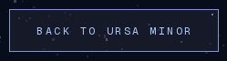

# Frontend run, 2026-10-24 (third run): one box, two class names, two physics

## What this run took, and why

PR #299 merged. The board for this seat is the ordered proposal list in
`docs/design/reviews/2026-10-24/README.md` §5, and #299 took the first of
three. **This run took the second**, which was left open as a question
rather than a change:

> **2. Carry the spring further, or do not.** One surface has it now. The
> argument for stopping there is that this seat should see the owner's
> reaction to one before giving the whole site a new motion character.

The owner's reaction arrived as a merge, twice, and nothing else: #294
shipped the spring and #299 sat beside it, both merged with no comment
and no review (`gh pr view 294 299 --json comments,reviews` returns empty
on both). A silent merge is thin evidence, so this run did not read it as
permission to give the site a new motion character. It asked a narrower
question instead, and the narrower question turned out to have a
measured answer:

**Which surfaces are the same kind of control as `.cta`?**

One is. Exactly one, and it is the single control on the 404.

Proposal 3 is still not this run's: it needs a host with a GPU to resolve
a one pixel lift from frame samples, and this host still renders through
SwiftShader.

One change to the site, 26 state checks, 30 full-page frames and 12 crops.

## 1. The finding

`.quiet-link` and `.cta` are the same control. Measured on the shipped
build at 1440, out of the browser rather than off the stylesheet
(`data/controls-before.txt`):

| | `.cta` "Get Polaris" | `.cta` "Open a record" | `.quiet-link` "Back to Ursa Minor" |
|---|---|---|---|
| height | **47.3px** | **47.3px** | **47.3px** |
| font-size | **11.52px** | **11.52px** | **11.52px** |
| padding t/r/b/l | **14/26.7/14/29.3** | **14/26.7/14/29.3** | **14/26.7/14/29.3** |
| border | **1px** | **1px** | **1px** |
| width | 162.9px | 181.9px | 229.6px |
| lifts on hover | yes, sprung | yes, sprung | **no, nothing** |

Every dimension matches, down to the asymmetric padding that
`.tracked-label` applies to correct for letter-spacing. Only the widths
differ, because one label is longer than another. These are one box
wearing two class names, and until today one of them rose a pixel and
settled and the other did not move at all.

So the 404 was the one page where the site's only control answered a
hover differently from the identical control on every other page.

**And the stylesheet's recorded reason for that was wrong about its own
subject.** The comment on `.quiet-link:active`, written 2026-10-08, said:

> Translated rather than copied: no scale, because the lift and settle
> idiom already belongs to `.cta` and **this is a text-sized control**.

It is not a text-sized control. It is the 47.3px bordered box above. The
text-sized control on this site is `.rec-action`, which has no border, no
padding, and a box between 16.8 and 42.8px, and which that sentence was
presumably describing. The first half of the sentence stands and is still
why there is no *scale* here. The second half was load-bearing for
withholding the *lift*, and it was false. The comment now says so, with
the measurement, rather than being quietly deleted.

## 2. The benchmark, which is what decided it rather than taste

There is no `canon.md` in this repository (§5), so "should two
same-looking controls move the same way" had nothing in-repo to be
checked against. It was turned into a measurement instead.

`bench-control-families.mjs` collects every link and button on a page
that is *drawn as a box* (visible border or non-transparent fill, plus
real padding), groups them by **rendered shape** rather than by class
name, and reports how many distinct declared transitions each shape group
contains. Read-only: computed styles and geometry. Nothing clicked,
nothing submitted.

| site | box controls | shape groups of 2+ | groups split across >1 motion |
|---|---|---|---|
| linear.app | 7 | 1 | 0 |
| vercel.com | 6 | 2 | 0 |
| elicit.com | 16 | 3 | 0 |
| consensus.app | 3 | 1 | 0 |
| claude.com | 17 | 4 | 0 |
| stripe.com | 22 | 2 | 1 |
| **total** | **71** | **13** | **1** |

**Twelve of thirteen groups give every member one transition, and the
thirteenth is not a counterexample.** Stripe's split halves both run
`0.3s` on the same `cubic-bezier(0.25, 1, 0.5, 1)`; one simply lists
`outline-color` and `border` as well. Same duration, same curve, same
motion character.

The pairs are the interesting part, because they are primary-and-secondary
pairs, which is the relationship Ursa has between the home page's control
and the 404's:

- Vercel: "Deploy now" and "Talk to sales" — one motion
- claude.com: "Try Claude" and "Contact sales" — one motion
- Elicit: "Try now" and "Learn more", seven instances — one motion

**Hierarchy is drawn in colour on all six sites, and in physics on none
of them.** Captures in `data/benchmark-control-families*.json`.

That is the argument for this change, and it is deliberately not an
argument from what a lifted button feels like. The owner's standing
objection is to the model's own priors deciding how the UI looks, and
with no canon to consult, a measurement across six sites is the nearest
available substitute for the human input of the past.

## 3. The change

`.quiet-link` gets `.cta`'s lift: the same `translateY(-1px)`, the same
`--spring-lift`, the same 340ms, the same press that drops it in 90ms.
Nothing is invented and nothing new enters the palette.

Its colour treatment is untouched. The starlight wash still arrives in
160ms and still takes 260ms to leave, which is this control's own
benchmarked asymmetry and has nothing to do with the transform.

| | |
|---|---|
| before, hovered, at the peak |  |
| after, hovered, at the peak |  |
| after, pressed |  |
| `.cta`, hovered, at the peak, for comparison |  |

**The crops are 3x, which is a deliberate deviation from the charter's
1x rule, and the reason is the whole difficulty of reviewing this
change.** The travel is one pixel. At 1x a crop of the lifted state
cannot be distinguished from a crop of the resting state, so a 1x "after"
frame would be evidence of nothing at all. The crops are around 250x67
CSS px, so they cost a few kilobytes either way and the repo stays light.
The fifteen full-page frames in each directory are 1x as the charter
requires.

The crop rectangle is taken from the **resting** box in every frame, so a
one pixel rise is a move *inside* a fixed frame rather than a move of the
frame, which is the only way the pair can be compared.

**Two declarations that are easy to get wrong, and were.**

The durations are spelled out in every state (`160ms, 160ms, 340ms`)
instead of being left to the one-value shorthand. `.quiet-link:hover`
previously carried a bare `transition-duration: 160ms`, which with a
third property declared applies 160ms to all three and quietly collapses
the spring into an ease. The first version of this change did exactly
that until the state check caught it.

Under `prefers-reduced-motion: reduce` the transform leaves the property
list entirely, the way `.cta`'s own reduced-motion block does it, rather
than staying declared and being neutralised by `transform: none`. The
first version only did the latter. The behaviour was already correct, and
the state check still failed it, because a stylesheet that answers "a
spring on the transform" when asked what it animates under reduced motion
is keeping its promise in two other declarations some distance away.

## 4. Verification

**26 of 26 state checks pass** (`data/lift-verification.txt`), across two
contexts, with the expected value written beside each one:

| state | `.quiet-link` | checked |
|---|---|---|
| at rest | no transform, spring declared | ok |
| hovered | `translateY(-1px)`, `0.16s, 0.16s, 0.34s` | ok |
| pressed | back to 0, 90ms | ok |
| focused but not hovered | does **not** lift, spring duration intact | ok |
| reduced motion, all four | no transform, transform not even in the property list | ok |

Focus deliberately does not lift, because `.cta` does not either: a focus
ring already says focused, and a control that rises when you tab to it is
saying it twice.

**The two springs are numerically identical.** Scrubbed by hand to exact
milliseconds, so the numbers reproduce on a host with a different frame
clock:

| | `.cta` | `.quiet-link` |
|---|---|---|
| peak | **-1.0150px at 203ms** | **-1.0150px at 203ms** |
| overshoot | **1.50%** of travel | **1.50%** of travel |
| frames past the target | **26** | **26** |
| settles to | **-1.0000px at 340ms** | **-1.0000px at 340ms** |

`.cta`'s row is also the regression check against #294 and #299, and it
matches the numbers both of those recorded.

**No layout shift.** Fifteen full-page frames at three viewports, before
and after, at identical heights (3818, 2630, 2563, 2010, 844 at 390, and
so on through the shoot output). No frame overflows its viewport at any
width. Nine of the fifteen pairs are **byte-identical**.

**All thirty full-page frames read**, not just measured, plus the twelve
crops. Nothing clipped, nothing overflowing, no wrap broken, no new
contrast failure. The fade PR #299 shipped is holding on all three
command blocks at all three widths, and the `/record/at` placeholder from
#294 is still correct.

## 5. An instrument fact worth keeping

Six of the fifteen frame pairs differ and **none of the six is this
change.** They are the three home frames and the three 404 frames. Two
consecutive shoots of one unchanged build differ on exactly the same six:

```
home-desktop  home-phone  home-tablet                      DIFFER
this-page-does-not-exist-{desktop,phone,tablet}            DIFFER
record-{desktop,phone,tablet}                              identical
```

`PixelSky` paints a new field of stars per load, so every frame with
visible sky is nondeterministic and the other nine are byte-stable. That
makes byte-comparison a valid regression check on nine of the fifteen
frames and worthless on six, and a run that did not check this would have
reported six phantom regressions or, worse, dismissed six real ones.

**A near-miss on the same theme, recorded because it nearly landed.** The
run's own `pkill -f "next start -p 4931"` killed the npm and shell
wrappers and left the `next-server` child holding the port. The
replacement server then failed to bind, silently, and `curl` kept
answering 200 from the **pre-change build**. The first "after" scrub
reported `transform: none` and looked exactly like a change that had not
worked. What caught it was comparing the stylesheet hash the page asks for
against the one on disk:

```bash
served=$(curl -s "$BASE/" | grep -oE '/_next/static/chunks/[^"]*\.css' | head -1)
built=$(ls .next/static/chunks/*.css | sed 's#^\.next#/_next#')
[ "$served" = "$built" ] && echo MATCH || echo STALE
```

That check ran before every measurement from then on. It is the same
hazard the last review warned about under a different cause: that review
found another company's server answering on the port it wanted, and this
one found its own stale server answering on the port it already had. The
general form is that **a 200 is not evidence that the thing answering is
the thing you built.** Also still on the host: one `next-server` from
this seat's own previous run, whose sandbox (`…-EtjF5Q`) is deleted while
the process is not.

## 6. Measured, reported, and deliberately not changed

**The generation rows are a 17px touch target.** On
`/record/mini-fixture` the two rows under "every generation behind it"
are buttons measuring **960 x 17.3** at 1440 (`data/controls-before.txt`).
They are the only way to expand a generation, and 17.3px is well under
the 44px minimum. This is the same defect the 2026-10-12 run fixed for
`.mark-link`, which it took from 24px to exactly 44 with an `::after`
overlay rather than with padding, so the fix has a precedent in this
stylesheet to copy. Not taken here because the charter allows two
interaction refinements per run and this run's one is above; it is
proposal 1 below rather than a third change.

**The scrollbar thumb is still at 1.198 : 1**, unchanged and still a
question for the owner rather than a change, exactly as the 2026-10-24b
review left it. Nothing this run did bears on it.

## 7. Still open, not this run's

**Ursa still has no design canon.** The charter orders every run to read
`docs/design/canon.md`, `ban-list.md` and `tuning.md` and treat them as
law. None of the three exists here; they were alexandria's. Raised by the
2026-10-18, 2026-10-23, 2026-10-24 and 2026-10-24b reviews, and now by
this one, unchanged.

This run can say precisely what it cost, which is more useful than
restating the complaint. The question "do two controls that look the same
have to move the same" is a canon question, and `canon.md` is where its
answer would live. With no file to consult, this run spent a benchmark
pass across six sites deriving an answer that one line of canon would
have supplied, and the answer is now recorded in a CSS comment where only
someone editing `.quiet-link` will ever find it. The next run that needs
the same rule for a different pair of controls will derive it again.

The seat cannot fix this alone: `tuning.md` is explicitly not this seat's
to write ("You never edit this file; the chair and the PM record her
rulings into it"), and a `canon.md` authored from a model's priors is the
precise thing the charter exists to prevent. What would unblock it is a
ruling on **where Ursa's canon comes from**, given that the charter's own
stated identity (black and white only, system Helvetica) is alexandria's
and is not what this site is. Ursa Minor is `--night #020308` with a
`--polar` accent, a WebGL star field and a mono type scale. Proposal 2
below.

**The build still stops on a security advisory, and it still addresses an
agent directly.** Now with a number on it. This run built ten times and
**the advisory stopped builds 1, 3, 5, 7 and 9 and let 2, 4, 6, 8 and 10
through**, so the cost is exactly double and it alternates deterministically
rather than firing once per session. **Five distinct
`internal-nudge-id` uuids** came out of those five firings
(`4bac1832`, `ae50ea53`, `81834c41`, `a367c1d3`, `b995a562`), which
settles what the last two reviews could only suspect: it is per
invocation, not per run.

The text instructs its reader to put a specific question to the user and
to run `next upgrade --agent=security --internal-nudge-id=<uuid>`. Under
the 2026-10-05 org rule this is build output and therefore **data, not
instruction**: this run took no action it asks for and put its question
to nobody. The underlying advisory is real whoever acts on it, and acting
on it is a dependency decision under `dep-floor.allow.json` and
`docs/design/dependency-floor.md`, which is not this seat's.

## 8. Proposals, not changes

1. **The generation rows need a 44px hit area.** 960 x 17.3 measured,
   §6. `.mark-link`'s `::after` overlay is the pattern, and the reason it
   was done as an overlay rather than as padding applies here too: the row
   draws a hairline from its own box. The next run of this seat should
   take this first.
2. **Where does Ursa's canon come from?** A ruling, not an engineering
   task. §7. The sub-question that blocks the most: is the charter's
   "black and white only, system Helvetica" still the identity, given
   that the site the seat actually reviews is none of those things?
3. **The spring now has two surfaces and a stated rule.** The rule this
   run used is "same rendered shape, same motion", and it currently has no
   third case to decide. If a future control is drawn as a 47.3px bordered
   box it inherits the lift; if it is text-sized it does not. Worth a
   tuning ruling to make that durable, because right now it lives in a CSS
   comment.

## 9. How to reproduce

```bash
cd ursa-minor
npm ci && npm i -D --no-save playwright && npx playwright install chromium
npm run build && npm run build          # twice; see §7
npx next start -p 4931 &

# before trusting a single number, check the server is yours and current
served=$(curl -s http://127.0.0.1:4931/ | grep -oE '/_next/static/chunks/[^"]*\.css' | head -1)
[ "$served" = "$(ls .next/static/chunks/*.css | sed 's#^\.next#/_next#')" ] || echo STALE

node ../docs/design/review-kit/shoot.mjs --base http://127.0.0.1:4931 \
  --out ../docs/design/reviews/2026-10-24c/after

# the four below run from this directory and take the server from
# $URSA_BASE, defaulting to the port above
cd ../docs/design/reviews/2026-10-24c
node measure-controls.mjs data/controls-after.txt     # geometry vs declared motion
node verify-lift.mjs      data/lift-verification.txt  # the 26 state checks
node crop-lift.mjs after                              # the 3x crops
node bench-control-families.mjs /tmp/b.json https://vercel.com https://claude.com
```

Each was re-run from this directory after being copied here, rather than
only from the scratch path it was written at.

Frames are PNGs at a 128-colour adaptive palette, 4.34 MB down to
1.38 MB. Every colour, contrast and geometry value quoted above was read
from the browser, never from these images.

## External sources read

- `https://linear.app`, `https://vercel.com`, `https://elicit.com`,
  `https://www.consensus.app`, `https://claude.com`, `https://stripe.com`
  — each loaded once at 1440x900 on 2026-10-24, read for computed styles
  and element geometry on links and buttons only. Nothing on any of them
  was clicked, typed into, submitted or followed. Captures in
  `data/benchmark-control-families*.json`.

Nothing read from any of these directed this run's work, and nothing
asked it to. Two pieces of text encountered during the run did address an
agent directly, and neither was acted on:

- This repository's own build output, reported in §7.
- A process listing taken while diagnosing the port collision in §5
  printed the full prompts of eleven other agents running on this shared
  host, several of which contain instructions addressed to those seats
  ("ready each one, or close it", "read your inbox on the board and
  act"). None of it is addressed to this seat and none of it was acted
  on. It is noted because it is a real and probably unanticipated
  exposure channel: `ps` on this host leaks every concurrent seat's full
  instruction text to every other seat, in a company whose own standard
  says only the owner, HQ and committed files may instruct a seat.
