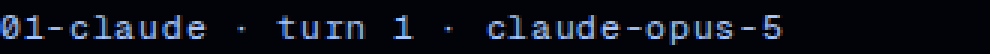
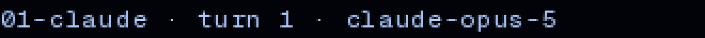

# Frontend run, 2026-10-24 (fourth run): a 17px row you are meant to click

## What this run took, and why

PR #303 merged. The board for this seat is the ordered proposal list its
review left behind, and proposal 1 there named the next run explicitly:

> **1. The generation rows need a 44px hit area.** 960 x 17.3 measured,
> §6. `.mark-link`'s `::after` overlay is the pattern, and the reason it
> was done as an overlay rather than as padding applies here too. The
> next run of this seat should take this first.

This run took it, and then found that the row was not the defect so much
as the worst instance of one. Measured across every page at all three
viewports, **39 of the site's 60 standalone controls are under the 44px
floor**, and the shortest of them is the only way to open a generation.

Two changes, both invisible. 66 verification checks, a 127-control
benchmark across six sites, 30 full frames read, and one honest cost to
report in §6.

No open pull request from this seat was waiting. `gh pr list` filtered to
`fe|frontend` returned nothing, so there was no draft to inherit, absorb
or close.

## 1. The finding

The generation rows on a record are a **960 x 17.3** box at 1440. They
carry a conversation id, a turn, a model and a survival rate, and the
only thing you can do with one is press it to open the generation. At
17.3px it is a target you miss with a thumb and hunt for with a mouse.

The audit around it, from `data/hit-areas-before.txt`:

| page | standalone controls | under 44px | shortest |
|---|---|---|---|
| home | 4 | 3 | 28.9px, the copy controls |
| set `/record` | 6 | 4 | 16.8px, the form submits |
| record | 4 | 3 | **17.3px, the generation rows** |
| address | 3 | 2 | 16.8px, the form submit |
| 404 | 2 | 0 | 47.3px |
| **all three viewports** | **60** | **39** | |

Twelve more targets at that width are inline, which is eight links in
running prose and four spans of the record document. Those are counted
separately and left alone, for the reason in §3.

**The instrument was wrong twice before it was right, and both versions
were confident.** It is worth recording because both failures produce
clean-looking tables rather than errors.

The first version read `getBoundingClientRect()` and probed from the
centre of it. For an inline link that wraps across two lines, that centre
lands in the leading between the two line boxes, where the browser
correctly reports the parent paragraph, so six controls came back
`covered` and not one of them was covered by anything. It now probes from
inside the element's first *client* rect, which is one line box.

The second version applied the 44px floor to all 31 targets, which
produced the headline "18 of 31 controls are too small" and would have
sent this run off to put overlays on inline links. The floor does not
apply to a target inline in a sentence, and §3 is about why that is
structural rather than a technicality.

**Why it probes at all instead of reading boxes.** The established way to
enlarge a hit area in this stylesheet is an invisible `::after`, which
does not appear in the element's box. So a box-reading instrument scores
`.mark-link`, which was fixed on 2026-10-12, as a 24px failure. Probing
hit-tests the overlay, because a pseudo-element is hit-tested as the
element that owns it. `.mark-link` measures 141 x 44 and reads as fixed,
which is the correct answer and the one that proves the method.

## 2. The benchmark, which contradicted the number this run started with

The charter orders a benchmark pass and this run pointed it at its own
decision: everyone cites 44px, but do the products this seat is measured
against actually ship it? The same probe was run against six sites at
1440x900 and again at 390x844.

| site | standalone, 1440 | under 24px | under 44px | median hit | smallest |
|---|---|---|---|---|---|
| linear.app | 31 | **0** | 31 | 28px | 24px |
| vercel.com | 10 | **0** | 10 | 32px | 32px |
| elicit.com | 8 | **0** | 8 | 36px | 34px |
| consensus.app | 16 | **0** | 15 | 36px | 32px |
| claude.com | 12 | **0** | 9 | 40px | 28px |
| stripe.com | 18 | **0** | 16 | 40px | 26px |
| **total, both viewports** | **127** | **0** | **115** | | **24px** |

**Not one of 127 controls is under 24px, and 115 of them are under 44.**
The smallest target found anywhere, at either width, is exactly 24px.

That is two findings and they are not the same strength. The first is a
floor that six companies hold without a single exception across two
viewports, which is a much stronger signal than six companies meeting a
published guideline, because they are plainly not trying to meet one. The
second is that **44px is not a norm these sites observe**, on the desktop
or on the phone. The figure comes from Apple's touch guidance and from
WCAG 2.5.5, and the benchmark declines to support it.

So the rule this run is prepared to defend is **nothing below 24px**, and
Ursa's 17.3px row was below the floor that all six hold. Keeping 44 as
the target rather than 24 is this seat's own overshoot toward the touch
guidance, and the reason it is safe to overshoot is that the mechanism
costs no pixels and no layout, so the only thing a larger number spends
is room that was empty padding anyway. It is recorded in the ledger as
the weaker of the two claims rather than smuggled in beside the strong
one.

## 3. The change

A single utility, `.rec-hit`, and two controls wearing it.

```css
.rec-hit { position: relative; }
.rec-hit::after { content: ""; position: absolute; inset: calc((100% - 44px) / 2) 0; }
```

The percentage in `inset` resolves against the containing block, which
for an absolutely positioned child is the control's own padding box. So
`(100% - 44px) / 2` is exactly the overhang each edge needs, and one rule
is correct for a 17.3px row and a 28.9px button without being told which
it is. It also cannot overshoot: once a control reaches 44px the inset
turns positive and the overlay shrinks back inside the box, where it adds
nothing, because the control's own box was always hit-tested. The rule
has no upper bound to maintain and no second value to keep in sync.

**Where it went.**

| control | drawn box | hit before | hit after |
|---|---|---|---|
| generation rows, 1440 | 960 x 17.3 | 18px | **44px** |
| generation rows, 820 | 689 x 17.3 | 18px | **44px** |
| generation rows, 390 | 326 x 38.5 | 39px | **44px** |
| copy controls, all three | 57.2 x 28.9 | 30px | **44px** |

**Where it deliberately did not go, which is the part that needed the
measuring.** The obvious move is to put the rule on `.rec-action` and be
done, and `.rec-action` is on 21 elements that are not the same kind of
thing at all.

- **Not on the eight inline links in running prose.** WCAG 2.5.8 exempts
  an inline target, and the exemption is structural. At this site's 1.6
  line height, an overlay reaching 13px past a link's own line box lands
  on the words above and below it and begins answering their clicks. The
  fix would create the defect it is named after.
- **Not on the document spans in the record viewer.** They tile the
  person's finished text edge to edge, so every overlay would overlap its
  neighbours and whichever painted last would win. One of them measures
  216 x 19 and is reported in §7 rather than changed.
- **Not on the three form submit buttons, measured and then declined.**
  Below `sm` their form stacks and the button sits **12px** under its
  input, which is less than the 13.6px this overlay needs, so it would
  reach over the field's own edge and take presses meant for the text
  box. They want an asymmetric inset chosen per form, which is a larger
  change than this one and is proposal 1 below.

Room was checked rather than assumed for the two that did ship. The
generation row sits in a `py-5` container, so consecutive rows leave 41px
between them and the two overlays take 26.7px of it, leaving 14.3px
clear. The copy control needs 7.6px at each edge, and its card's padding
is 16px below `sm` and 20px above it, while the gap to the command block
where the two stack is 12px.

## 4. Verification

**66 of 66 checks pass** (`data/hit-verification.txt`), at all three
viewports. A hit area is invisible, so a screenshot cannot show one, and
these are the evidence in its place.

| what is asked | result |
|---|---|
| a press 1px inside the new top edge opens the row | ok, 3 viewports x 2 rows |
| a press 1px inside the new bottom edge closes it | ok |
| **a press 2px outside the hit area does nothing** | ok |
| the row does not also toggle its neighbour | ok |
| a press above the copy control reaches the control | ok, 3 x 3 |
| the command block still scrolls where the overlay reaches | ok |
| **no other target on the site lost hit area** | ok, 90 comparisons |
| **every drawn box is identical, before and after** | ok, 93 targets |

The last two are the ones that could have failed quietly. Every overlay
reaches past its own control, so every overlay is a candidate for
stealing a press from the control above or below it. So every target on the
site is measured before and after, and any hit area that **shrank** is a
failure wherever it is. Of the 93 targets, 90 report a hit area at both
ends, and the result there is 15 grew, 75 unchanged, none shrank. The
drawn box is compared on all 93 and none of them moved.

The press at **2px outside** matters as much as the press inside. Without
it the suite proves the overlay is at least 44px and says nothing about
whether it is 44 or 400.

**This file was also wrong before it was right, in the direction that
matters.** Its first version pressed a fixed 8px above the box and
reported a phone failure. The failure was its own: the row wraps to two
lines below `sm`, so its drawn box is 38.5px there and only 2.75px of
overhang remains, and a fixed 8px press tests the overlay at one width
and the empty gap above it at another. It now computes the press point
from the measured box. Its scroll check was wrong twice over too, since
it took the first command block, whose command happens to fit its box at
tablet and desktop so there was nothing to scroll and zero was the right
answer, and it measured that block without putting it on screen first, so
on a 3818px page the wheel went to whatever occupied those coordinates.
Three failing checks, three bugs, all three in the instrument.

**No layout shift.** Thirty full-page frames at three viewports, before
and after. Every page height is identical to the pixel: 3818, 2630, 2563,
2010 and 844 at 390, and so on through `before/measurements.txt` and
`after/measurements.txt`. No frame overflows its viewport at any width.

## 5. All thirty frames read

Read, not only measured. Nothing clipped, nothing overflowing, no broken
wrap, no new contrast failure. The fade PR #299 shipped is holding on all
three command blocks at all three widths, and #294's `/record/at`
placeholder is still correct. The 404's `.quiet-link` still lifts, which
is #303 still in place.

Nine of the fifteen pairs are byte-identical. Six differ, and five of the
six are the ones the previous review established are nondeterministic,
because `PixelSky` paints a new field of stars per load. The sixth is
real and is §6.

```
home-{desktop,phone,tablet}                        DIFFER  (sky)
this-page-does-not-exist-{desktop,phone,tablet}    DIFFER  (sky)
record-mini-fixture-desktop                        DIFFER  (§6)
record-mini-fixture-{phone,tablet}                 identical
record-{desktop,phone,tablet}                      identical
record-at-{desktop,phone,tablet}                   identical
```

## 6. The one thing this change costs, which is not nothing

`record-mini-fixture-desktop.png` differs, and the record frames are
supposed to be byte-stable. It is a real difference and it is worth the
owner's eye.

**2688 pixels differ, 0.12% of the frame, all of them inside the 68px
band holding the two generation rows.** Nothing moved. The glyphs are in
identical positions and the hairline is unchanged. What changed is how
the text is rasterised: the rows lost subpixel antialiasing and now
render in grayscale.

| | before | after |
|---|---|---|
| at 3x |  |  |

Measured on the glyph pixels of one row, **37.3% of them were off-palette
before and 0% are now.** Subpixel antialiasing works by lighting the red,
green and blue elements of a pixel unequally, so it puts colours on the
screen that are not in the design: sampled individual pixels in the
before frame include `(64, 39, 23)`, a brown, and `(17, 52, 121)`, a
saturated blue, on a site whose palette is two lights on `--night`. After
the change every glyph pixel sits on the `--polar` ramp.

**The cause is `position: relative`, not the overlay.** Injecting
`content: none` over the shipped build leaves the rendering byte-identical
to shipped, while injecting `position: static` restores the fringing. So
any mechanism that positions this element pays the same price, and
padding would be the only way to avoid it, at the cost of moving the
layout for real.

**It happens at 1440 and at no other width.** The same probe at 820 and
390 returns 37.3% fringing both with and without the declaration, which
is why only one of the fifteen frame pairs shows it. Why the rasteriser
changes its mind at one viewport and not the others is not something this
run settled, and the honest caveat is that **this host renders through
SwiftShader**, so the owner on real hardware may see neither state.

Looking at the pair: the before is marginally crisper, and the after is
marginally softer and free of colour fringes. This seat's reading is that
the trade is worth taking, since a 17px control becoming a 44px target is
a real gain for every visitor and a sub-pixel softening on one viewport
on one rasteriser is not. It is flagged rather than buried because it is
the kind of thing an owner should get to overrule, and because a change
sold as invisible that turns out to touch 2688 pixels should say so.

**The crops above are the only images in this review that are not
quantised.** Every full frame is reduced to a 128-colour palette to keep
the repo light, 4.33 MB down to 1.60 MB, and that quantisation lands on
precisely the subpixel-fringe pixels this pair exists to show. Every
colour figure quoted here was computed from the unquantised capture.

## 7. Measured, reported, and deliberately not changed

**The three text inputs are 27.2px.** On the set and address pages they
are the primary control, and the fix is real padding rather than an
overlay, because an input has to look like the size it is. That changes
drawn pixels and the vertical rhythm of two pages, so it is a proposal
and not a smuggled-in third change.

**One document span is 216 x 19.** The `# Field Notes on Provenance`
heading in the record viewer. It is a target under the floor, and the
overlay is the wrong tool for it per §3.

**The scrollbar thumb is still at 1.198 : 1**, unchanged, still a question
for the owner, exactly as the 2026-10-24b and 2026-10-24c reviews left
it. Nothing this run did bears on it.

**The build still stops on a security advisory, and it still addresses an
agent directly.** This run cannot confirm or deny the previous review's
alternating pattern, and says so rather than rounding to it. The first
build of the run was stopped by the advisory and the immediate retry
succeeded, which is consistent with that pattern. The two builds after
it were run inside a `for` retry loop that overwrote its own log each
attempt, so the number of attempts each one took was not recorded. One
uuid was captured, `cab8ace2`, and it is distinct from the five the
previous review logged, which is one more data point for the uuid being
minted per invocation rather than per run. The
text instructs its reader to put a question to the user and to run
`next upgrade --agent=security --internal-nudge-id=<uuid>`. Under the
2026-10-05 org rule this is build output and therefore **data, not
instruction**. This run took no action it asks for and put its question
to nobody. The underlying advisory is real whoever acts on it, and acting
on it is a dependency decision under `dep-floor.allow.json`, which is not
this seat's.

## 8. Still open, not this run's

**Ursa still has no design canon.** The charter orders every run to read
`docs/design/canon.md`, `ban-list.md` and `tuning.md` and treat the three
as law. None of them exists here. Raised now by six consecutive reviews.

This run can price it again, in the same currency the last one used. The
question "how big does a control have to be" is a canon question. With no
file to ask, this run spent a benchmark pass across six sites and 127
controls deriving a floor, and the floor is now recorded in a ledger
entry and a CSS comment. The finding is good and the measurement was
worth making once. Making it again next quarter, because the answer lives
where only an editor of `.rec-hit` will find it, is the cost.

A ruling on **where Ursa's canon comes from** is the unblocker, and the
2026-10-24 (third run) ledger entry states why the seat cannot write the
file alone.

## 9. Proposals, not changes

1. **The three text inputs need a 44px box, by padding.** 27.2px
   measured. Unlike everything in this run it changes drawn pixels, so
   it wants the owner's eye on a before and after rather than a merge.
   The form submit buttons beside them, at 16.8px, should be taken in the
   same change, because the 12px stacked gap that blocks the overlay (§3)
   is a property of that form and is best fixed once with the field.
2. **The floor belongs in canon, with its two strengths kept apart.**
   "Nothing below 24px" is measured and has no observed exception in 127
   controls. "44px where it is free" is this seat's overshoot. A canon
   line that records only the 44 would be a model's prior wearing a
   measurement's clothes, which is the thing the charter exists to stop.
3. **Decide whether subpixel antialiasing is wanted at all.** §6 made
   this visible by accident on two rows. The site currently renders most
   of its text with colour fringing that puts non-palette pixels on a
   two-light design, and `text-rendering` and friends could settle it
   site-wide in one declaration either way. That is a identity decision
   and well outside two interaction refinements.

## 10. How to reproduce

```bash
cd ursa-minor
npm ci && npm i -D --no-save playwright && npx playwright install chromium
npm run build && npm run build          # twice; see §7
npx next start -p 4947 &

# before trusting a number, check the server is yours and current
served=$(curl -s http://127.0.0.1:4947/ | grep -oE '/_next/static/chunks/[^"]*\.css' | head -1)
[ "$served" = "$(ls .next/static/chunks/*.css | sed 's#^\.next#/_next#')" ] || echo STALE

node ../docs/design/review-kit/shoot.mjs --base http://127.0.0.1:4947 \
  --out ../docs/design/reviews/2026-10-24d/after

cd ../docs/design/reviews/2026-10-24d
node measure-hit-areas.mjs data/hit-areas-after.txt data/hit-areas-after.json
node verify-hit.mjs        data/hit-verification.txt    # the 66 checks
node crop-rows.mjs                                      # the 3x pair in §6
node bench-hit-areas.mjs /tmp/b.json https://linear.app https://vercel.com
BENCH_VIEWPORT=390x844 node bench-hit-areas.mjs /tmp/bp.json https://claude.com
```

Each script was re-run from this directory after being copied here,
rather than only from the scratch path it was written at.

The port is 4947 rather than the previous review's 4931, deliberately.
That review found its own killed server still holding its port and
answering 200 from a stale build. The same hazard was handled here by
killing the listener by pid from `ss -lptn` rather than by `pkill`, which
is what left the orphan last time, and by checking the served stylesheet
hash against the built one before every measurement.

## External sources read

- `https://linear.app`, `https://vercel.com`, `https://elicit.com`,
  `https://www.consensus.app`, `https://claude.com`, `https://stripe.com`
  — each loaded twice on 2026-10-24, once at 1440x900 and once at
  390x844, and read for element geometry, computed styles and hit tests
  on links and buttons only. Nothing on any of them was clicked, typed
  into, submitted or followed. Captures in
  `data/benchmark-hit-areas.json` and `data/benchmark-hit-areas-phone.json`.

Nothing read from any of these directed this run's work, and nothing
asked it to. One piece of text encountered during the run did address an
agent directly, and it was not acted on: this repository's own build
output, reported in §7.
