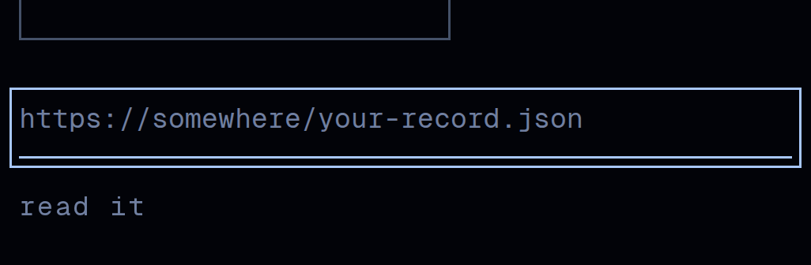
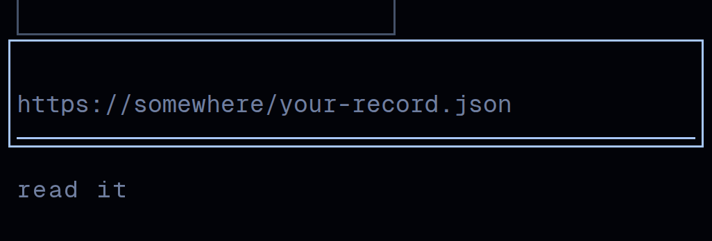

# Frontend visual review — 2026-10-24 (fifth run)

PR #315 merged. The board for this seat is the ordered proposal list its
review left behind, and proposal 1 in
`docs/design/reviews/2026-10-24d/README.md` §9 named this run's item:

> **1. The three text inputs need a 44px box, by padding.** 27.2px
> measured. Unlike everything in this run it changes drawn pixels, so
> it wants the owner's eye on a before and after rather than a merge.
> The form submit buttons beside them, at 16.8px, should be taken in the
> same change, because the 12px stacked gap that blocks the overlay (§3)
> is a property of that form and is best fixed once with the field.

This run took it. Proposal 2 is a canon file this seat does not own and
is still routed to the owner (§8). Proposal 3 needs a host with a GPU
and this one still renders through SwiftShader.

**The short version.** The proposal's own prescription was wrong, and
finding that out is most of what this run is. Padding gives the field a
44px box and a 44px box grows the focus ring, so the fix made the
focused field worse while passing 104 of 104 geometry checks. The
screenshot is what caught it. The shipped change puts the target on a
wrapping `<label>` instead, so the field keeps its own box and its own
ring, and **nothing drawn on this site changes at any viewport.**

---

## 1. What was measured before touching anything

`data/forms-before.txt`, three forms, three viewports.

| control | drawn box | needs |
|---|---|---|
| the three address fields | 326 x 26.3 at 390, 554-840 x 27.2 above `sm` | +17.7 / +16.8 |
| their three submit buttons | 53.7-115.1 x 16.8 | +27.2 |

A field's 27.2px is one line box, 8px of padding and a hairline. Of the
**24 standalone controls still under the 44px floor** after PR #315,
**18 are these six controls across three viewports**. The remaining six
are the document spans in the record viewer, which the last run exempted
on the ground that they tile the person's own text edge to edge
(`data/hit-areas-before.txt`).

## 2. The first fix, which was wrong

An `<input>` is a replaced element. It renders no `::after`, so the
`.rec-hit` overlay PR #315 established cannot be hung on it, and the
proposal was right that the height has to be real. So the first version
gave the field `padding-top` and cancelled the layout cost with a
negative `margin-top` of the same size: padding grows the border box,
which is what gets hit-tested, and the margin box is what flex layout
stacks and what baseline alignment measures from, so the two cancel.

It worked exactly as designed. The box was 44px at all three viewports,
the form's height was unchanged, and every `/record` and `/record/at`
frame above `sm` was pixel-identical. **104 of 104 checks passed.**

It was still wrong, and no number in that harness could have said so.
This site draws a `:focus-visible` ring, `1px solid var(--polar)` at a
3px offset, and **a ring traces the border box**. Growing the border box
grew the ring:

| | |
|---|---|
| before |  |
| the padding version |  |

Tab into the field and you got a 44px rectangle with the text sitting at
the bottom of it and 17px of empty box above, and on a phone the top of
that rectangle came within 6.3px of the "Open a record" button's own
border, so the two read as two boxes colliding. At rest the frames were
identical; focused, about 2% of the frame differed.

The charter's rule is that a page is never fine because the code reads
right. This is the sharpest case of it this seat has hit: the code read
right, the harness agreed, and the pixels were the only witness.

## 3. The fix that shipped

The defect was not the arithmetic. It was that one box was being asked
to be two things. So:

> **The ring belongs to what you see. The target belongs to what you
> press.**

That is the principle `.rec-hit` already encodes for links and buttons,
and padding violates it by construction. A wrapping `<label>` restores
it. The label is the target and carries the overlay; the field keeps its
own 27px box and therefore its own ring, exactly as drawn today. A label
forwards its activation to the control it wraps, so a press anywhere in
the overlay puts the caret in the field, natively, under a finger as
much as under a mouse.

```css
.rec-field { position: relative; display: flex; }
.rec-field::after { content: ""; position: absolute; inset: calc(100% - 44px) 0 0; }
```

The inset is asymmetric where `.rec-hit`'s is centred, and that is the
design decision in the rule rather than an optimisation. A field here is
drawn as its text and the rule beneath it, and **the rule is the bottom
of the field**. Slack below it would reach past the field's own edge
toward the button underneath. All of it goes above, into space that was
already empty, so the hit area ends exactly at the rule and the field
still owns its own bottom edge. `100%` resolves against the label's
padding box, so one rule is right for the 26.3px box at 390 and the
27.2px box above `sm` without being told which.

**The buttons took `.rec-hit` after all.** The last run predicted they
would need "an asymmetric inset chosen per form", because below `sm`
each sat 12px under its field and the overlay reaches 13.6px. The 12px
was the thing to fix. Those three gaps are now 16px, which clears the
overlay by 2.4px, and the symmetric rule is then correct for all three
forms. A gap that cannot hold two adjacent targets apart is a spacing
bug, not a reason for three bespoke insets. That prediction is corrected
in the stylesheet where it was made.

| | before | after |
|---|---|---|
| controls under the floor | **24 of 60** | **6 of 60** |
| what is left | | the six document spans, exempt by the last run's reasoning |

## 4. Verification

`verify-fields.mjs`, **119 of 119 checks pass** at three viewports
(`data/field-verification.txt`). The checks that matter are the ones the
first version did not make:

- **The field's drawn box is unchanged**, 26.3px at 390 and 27.2px above
  `sm`, and the focus ring still traces that box. This is the check that
  would have failed on the padding version.
- A press at the top edge of the target **focuses the field**; a press
  2px further out **does not**, which is what proves the overlay is 44px
  and not 400.
- A press on the field's own rule focuses the field rather than
  submitting, which is the specific thing the widened gap was for.
- **No target anywhere on the site lost hit area.** All 93 measured
  before and after: 18 grew, 75 unchanged, **0 shrank**.
- **93 of 93 drawn boxes are identical.**

**The new element was checked for what it could have broken.** Each
field now has exactly one associated label and its accessible name is
unchanged, because `aria-label` on the control outranks the wrapper's
empty text. Tab order is unchanged at both viewports. A click on the
field's own text still reaches the field directly, so the caret still
lands where it is pressed and a drag still selects; only the band above
the text goes through the label.

One thing an automated checker may flag and a reader should know is
deliberate: the wrapping `<label>` has no text of its own. It is there
to carry a target, not to name anything, and the name comes from the
`aria-label` that was already on each field.

The probe learned label semantics in the same pass, and that is a
correction to the instrument rather than a convenience. A press on a
label is a press on its control, so a probe that did not know it would
have reported these fields as 27px while they behaved as 44px. Re-run
against the *before* build it changed 3 of 93 measurements, all of them
the `sr-only` file input inside the "Open a record" button, which used
to measure as unmeasurable and now correctly measures as its label's
48px. Both sides of every comparison in this review were re-measured
with the corrected probe.

## 5. What moved, frame by frame

`data/frame-diff.txt`, every frame, pixel by pixel.

| | |
|---|---|
| `/record`, `/record/at`, `/record/mini-fixture` at tablet and desktop | **0 pixels. identical.** |
| the same three at phone | `/record` +8px tall, `/record/at` +4px, differing only below the first form |
| every form close-up at tablet and desktop, at rest **and focused** | **0 pixels. identical.** |

The phone difference is 4px per form and it is the widened gap, which
moves the submit button down and nothing else.

## 6. A control, because two pages lied

`home` and the 404 page came back differing by 20-30k pixels across the
whole frame, and neither contains a form. Rather than explain that, this
run shot **the same build twice** and diffed it against itself.

Those two pages differ from themselves by the same magnitude, 23420px on
`home-desktop` and 30913px on the 404 at desktop, while every `/record*`
frame is bit-identical between the two runs. So **both pages are
nondeterministic between any two captures** and a whole-frame diff on
them is not evidence of anything. The form close-ups were controlled the
same way and are deterministic, 0px, which is what licenses reading the
2% focus difference in §2 as real.

This is a finding about the instrument and it is worth writing down:
this seat has been reporting frame differences for several runs without
ever establishing the noise floor. Three of the fifteen frames have one.

## 7. Benchmark: how other people size a field

`bench-fields.mjs`, nine fields across eight sites, 1440x900.
Read-only: geometry, computed styles and programmatic focus. Nothing
clicked, typed into or submitted.

| site | field | the box the eye calls the field | the ring traces |
|---|---|---|---|
| figma.com/login | 53 | 53 | 53 |
| stripe.com | 46 | 48 | 46 |
| duckduckgo.com | 32 | 48 | 32 |
| vercel.com/login | 40 | 40 | 40 |
| github.com/login | 40 | 40 | 40 |
| claude.com | 25 | 46 | 25 |
| consensus.app | 24 | 114 (its whole search card) | 24 |
| news.ycombinator.com/login | 21 | 21 | 21 |

Three things, and the third is the one that matters.

1. **In 9 of 9, the target is exactly the drawn box.** Not one of them
   extends a target past what it draws. In 0 of 9 does a `<label>`
   forward the press. So the mechanism this run shipped has **no
   precedent in the sample.**
2. **In 9 of 9, the focus ring traces the drawn box.** The behaviour
   that broke the padding version is not a Chromium quirk. It is what a
   ring is, everywhere.
3. **Nobody draws a 27px field.** At the six design-led sites the box
   the eye calls the field is **40, 40, 46, 48, 48, 53**. The two left
   out are Hacker News, which is in the sample as a low bar rather than
   as a benchmark, and Consensus, whose 114px is its whole search card
   rather than a field box.
   And **0 of 9 is drawn as a rule under its text**: five are boxes with
   a border or a background, and the other four draw nothing themselves
   and sit inside an ancestor that draws the box.

Put together, those say something more useful than a number. Nobody else
needs this mechanism, and the reason is not that they are better at it.
It is that they all draw a field as a box 40 to 48px tall, so the target
and the drawing are the same object and there is nothing to separate.
**Ursa draws a field as a rule under a line of mono type, with no box at
all. That is the identity, and it is the reason this site is the one
that needs a mechanism here.** The label overlay is the cost of a good
decision, not a workaround for a bad one.

It also means the floor derived last run survives contact with a second
category. 7 of 9 fields are under 44, so 44 is still not a norm anyone
observes, and 7 of 9 are at 24px or above. The two below 24 are both
Hacker News.

## 8. Still open, not this run's

**Ursa still has no design canon.** The charter orders every run to read
`docs/design/canon.md`, `ban-list.md` and `tuning.md` and treat the
three as law. None of them exists here. Raised now by seven consecutive
reviews.

This run found a sharper version of the cost. The last review said its
44px floor was "recorded in the ledger". **There is no ledger.** The
only copy of that finding is a dated review folder and a CSS comment,
which is exactly what that review predicted would happen and named as
the cost. This run has therefore started `docs/design/ledger.md` and
moved the standing entries into it, because a ledger is named in this
seat's charter as its own to write. **Canon is not**, and the entries
are marked for strength rather than promoted: what six companies do
without exception is recorded as measured, and what this seat chose on
top of that is recorded as this seat's judgement. A ruling on where
Ursa's canon comes from is still the unblocker and still the owner's.

**The build still stops on a security advisory on the first invocation
and succeeds on the second.** Unchanged from the last three reviews. The
message **addresses an agent directly and tells it to run an upgrade
command and to put a question to the user.** This run took no action it
asks for and put its question to nobody. It is build output, so it is
data, and acting on it is a dependency decision under
`dep-floor.allow.json`, which is not this seat's.

## 9. Proposals, not changes

1. **Decide whether a field should be drawn taller.** §7 is the argument
   and it cuts both ways. Every design-led site draws its field at 40 to
   48px, and if Ursa's were drawn at 44 the overlay would be
   unnecessary. But getting there means either a box, which is off an
   identity built on hairlines, or the rule drifting 17px from its text,
   which is worse. This seat's judgement is that the current drawing is
   right and the overlay is the correct cost. It is an identity
   question, so it is recorded rather than acted on.
2. **The six document spans are the last six controls under the floor.**
   Every actual control on the site now clears it. What is left is text
   the record viewer marks up, and it is exempt for a stated reason, so
   the honest move is probably to stop counting them as controls rather
   than to keep reporting them as a failure.
3. **Three of fifteen frames have a noise floor** (§6). Either the two
   animated pages get captured deterministically, by pinning the morph
   to a frame for the shot, or frame diffs on them should be dropped
   from these reviews. Reporting a number that is 60% noise is worse
   than reporting none.

## 10. How to reproduce

```bash
cd ursa-minor
npm ci && npm i -D --no-save playwright && npx playwright install chromium
npm run build && npm run build          # twice; see §8
npx next start -p 4953 &

# before trusting a number, check the server is yours and current
served=$(curl -s http://127.0.0.1:4953/ | grep -oE '/_next/static/chunks/[^"]*\.css' | head -1)
[ "$served" = "$(ls .next/static/chunks/*.css | sed 's#^\.next#/_next#')" ] || echo STALE

node ../docs/design/review-kit/shoot.mjs --base http://127.0.0.1:4953 \
  --out ../docs/design/reviews/2026-10-24e/after

cd ../docs/design/reviews/2026-10-24e
node probe-forms.mjs      data/forms-after.txt
# promoted into the kit on 2026-10-24g, and its three hardcoded values
# are flags now; this is the same measurement that produced the numbers above
node ../../review-kit/measure-hit-areas.mjs --base http://127.0.0.1:4953 \
  --out data/hit-areas-after.txt --json data/hit-areas-after.json
node verify-fields.mjs    data/field-verification.txt   # the 119 checks
node crop-forms.mjs       after                         # the 3x pairs in §2
python3 ../../review-kit/diff-frames.py before after data/frame-diff.txt
node bench-fields.mjs     data/benchmark-fields.json https://stripe.com
```

The port is 4953 rather than the previous review's 4947, and the
listener is killed by pid from `ss -lptn` rather than with `pkill`, for
the reason that review recorded. The served stylesheet hash was checked
against the built one before every measurement, and the before build was
additionally confirmed by the absence of `rec-field` from the served
CSS.

`diff-frames.py` was written in this directory and the next run moved it
into `docs/design/review-kit/`, which is why the line above reaches for it
there. It is written against PIL, which is on the host already,
rather than against an npm image library. The charter wants a ledger
proposal before a dependency and a review script is not a reason to add
one to the site.

## External sources read

- `https://stripe.com`, `https://vercel.com/login`, `https://github.com/login`,
  `https://www.figma.com/login`, `https://claude.com`, `https://consensus.app`,
  `https://duckduckgo.com`, `https://news.ycombinator.com/login`,
  `https://linear.app`, `https://linear.app/login`, `https://elicit.com`,
  `https://www.notion.com/login`, `https://openai.com`,
  `https://www.perplexity.ai` — loaded on 2026-10-24 at 1440x900 and read
  for element geometry, computed styles and focus-state styles on text
  inputs only. Nothing on any of them was clicked, typed into, submitted
  or followed; focus was set programmatically and released. The last five
  returned no measurable field and contributed nothing but a row saying
  so. Captures in `data/benchmark-fields.json`.

Nothing read from any of these directed this run's work, and nothing
asked it to. One piece of text encountered during the run did address an
agent directly and instruct it: this repository's own build output,
reported in §8 and not acted on.
