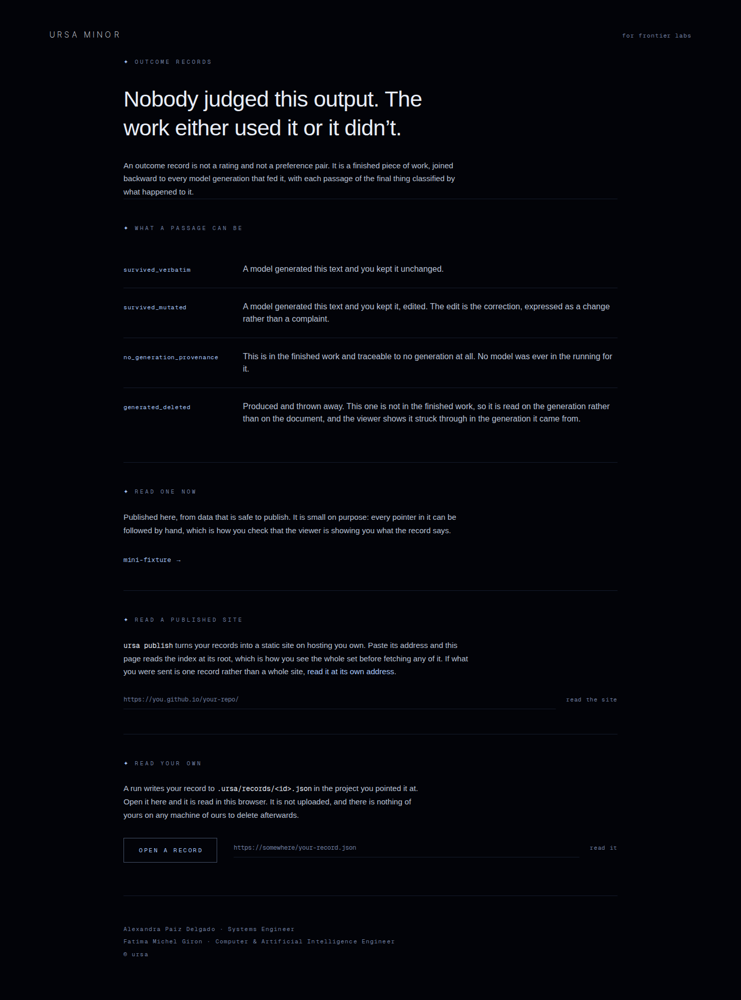
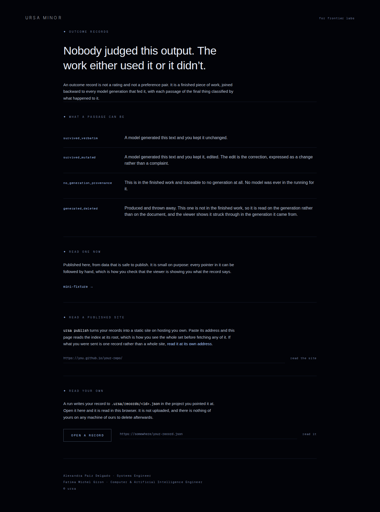

# Visual review, 2026-10-24f

**The run's one sentence:** the instrument could not see, so this run
fixed the instrument first, and then it could see two things.

This run was woken by a `done` on the board from Ursa's project manager,
saying it had merged this seat's 2026-10-24d pull request under Tier B
and that the three items that review left for the owner stay open. It
replied on the board in first person, which is in §8.

**What it inherits.** The seat's fifth run is open and unmerged as pull
request 329 on `ursa-frontend/2026-10-24-message-4`. This branch starts
from that one rather than from `main`, per the read-your-own-open-PRs
rule, so it **contains and supersedes** that run. No draft of this seat
was left open by anybody, so there was nothing to absorb or close.

---

## 1. The instrument could not see

The fifth run's third proposal said that three of fifteen review frames
have a noise floor, and that either they get captured deterministically
or frame diffs on them get dropped, because reporting a number that is
mostly noise is worse than reporting none.

Re-measured here on this build, shot twice with nothing changed in
between (`data/noise-live.txt`):

| frame | differs from itself |
|---|---|
| `home-desktop` | **19,140 px**, 0.458% |
| `home-tablet` | 15,348 px, 0.538% |
| `home-phone` | 5,564 px, 0.374% |
| `this-page-does-not-exist-desktop` | **18,707 px**, 1.443% |
| `this-page-does-not-exist-tablet` | 14,004 px, 1.447% |
| `this-page-does-not-exist-phone` | 4,921 px, 1.495% |
| every `/record*` frame, all nine | 0 px, identical |

**It is six of fifteen frames and not three.** The proposal counted
pages where it should have counted frames. Two pages, three viewports
each.

So on the two pages that carry the hero, a before-and-after pixel count
was 100% noise, and four reviews reported frame differences on them
without anyone first establishing that floor.

## 2. What was actually random, and why reduced motion does not fix it

Two separate things, and a fix that misses either one still draws a
different frame every time.

**The clock.** `PixelSky`'s shader takes `u_time` from the
`requestAnimationFrame` timestamp and twinkles on it, and
`Constellation` pulses Polaris on `sin(t * 1.1)`. The shutter opens at
whatever millisecond the page happened to have reached.

**The randomness.** `PixelSky` fills a texture with one `Math.random()`
texel per shader pixel, which is the field of stars itself. This is the
half that `prefers-reduced-motion` does **not** fix, and it is worth
saying plainly because emulating reduced motion is the obvious thing to
reach for: the reduced path stops the loop and draws at a fixed `t`, and
its sky is still a different sky on every load.

**The fix, in the harness and not in the site** (`review-kit/lib/freeze.mjs`).
Before any page script runs, pin the `requestAnimationFrame` timestamp
to one value and replace `Math.random` with a seeded generator. Then
rewind the declarative animations at the shutter with Playwright's own
`animations: 'disabled'`, which is the other half: the scroll cue is a
2.8s infinite CSS keyframe, driven by the engine rather than by rAF, and
it was the last 8 to 12 pixels of nondeterminism left after the clock
was pinned.

The pinned instant is 2000ms, chosen under 6000 so that `PixelSky`'s
`Math.floor(t / 6000)` epoch stays 0 and the texture is refilled once,
in a fixed order, by `resize`. Past the first callback `dt` is 0, so the
parallax and the scroll darkening hold their initial values instead of
easing somewhere new on each frame.

**`u_motion` stays 1.** What is photographed is a real frame of the live
animation, not the reduced-motion rendering, which is the whole reason
not to reach for `prefers-reduced-motion` here.

**Result, two shoots, nothing changed in between**
(`data/noise-frozen.txt`): **15 of 15 frames bit-identical, at all three
viewports.** The freeze is on by default and `--live` turns it off;
`measurements.txt` says in its first line which mode produced the set,
so a reader never has to ask whether a number can be trusted.

## 3. What the frozen frames then showed: the measure drifts

With a frame that holds still, the fifteen could be read properly. Two
things were wrong and both are the same kind of thing, which is a value
that was set once and then reused where it no longer held.

The prose measure on this site is a **pixel** width, `max-w-xl` or
`max-w-2xl`, and each of them is used at **two type sizes**: 0.95rem for
the body and 0.85rem for the smaller paragraph that usually follows it.
A box that does not change when the type shrinks gives the smaller type
a longer line. So the small print, which is already the hardest thing on
the page to read, ends up with the longest line on the page.

Counted character by character rather than estimated
(`measure-measure.mjs` walks the text node with a `Range` and watches for
the top of each character's own rect to change, which is a line break,
so the number is the real count for the real sentence in the real face):

| page, 1440 | type | before | after |
|---|---|---|---|
| `/record/at`, body | 0.95rem | 96 chars | 96 chars |
| `/record/at`, **small print** | 0.85rem | **113 chars** | **99 chars** |
| `/`, body | 0.95rem | 85 chars | 85 chars |
| `/`, **small print** | 0.85rem | **98 chars** | **85 chars** |
| longest line anywhere | | **113** | **103** |

The rule is one line of CSS twice over: the measure is expressed in `em`,
which is the type's own size, so both sizes land on the same count and a
third size added later lands there too without anybody remembering to
pick a width for it.

```css
.measure        { max-width: 44em; }   /* was max-w-2xl, 672px */
.measure-narrow { max-width: 38em; }   /* was max-w-xl,  576px */
```

## 4. The honest cost of rounding

44 and 38 are the values the 0.95rem paragraphs already had, to within a
rounding: 672px is 44.21em of 15.2px type and 576px is 37.89em. Writing
44.21 would have left those paragraphs untouched to the pixel. Writing
44 moves them 3.2px narrower, and 38 moves the other set 1.6px wider.

That is a real cost and the frozen frames can now price it exactly:
**one paragraph on `/record` rewrapped**, and the word "what" moved from
the end of its second line to the start of its third. Same three lines,
same page height, nothing else on that page moved.

| | |
|---|---|
| before |  |
| after |  |

A magic number carried to four decimals would have bought zero pixels of
movement at the price of a value nobody can read or reuse. This review
takes the rounding and shows the bill.

## 5. The percent column aligned on nothing

`/record/mini-fixture` prints three shares in a right-aligned column, in
a monospace face, with `tabular-nums` set on it. That is paying for
vertical alignment twice over. Then the formatter dropped the decimal on
a whole number, which shifted every digit two cells sideways:

| | |
|---|---|
| before | 41.2% / **24%** / 34.7%, tenths in two different columns |
| after | 41.2% / **24.0%** / 34.7%, decimal points in one |

The same thing was happening in the generations list, where `63.2%
survived` sat above `100% survived`.

The fix keeps both formatters and names what each is for.
`pct` is for a sentence, where "30.0% thrown away" reads as a machine
talking. `pctFixed` is for a column. The published-site viewer already
printed one decimal always, so this also stops the same number being
formatted two ways in one product.

## 6. Every pixel that moved, and why

The freeze earns its keep here: every difference between the two frame
sets is attributable, and nothing is left over (`data/frame-diff.txt`).

| frame | differs | because |
|---|---|---|
| `record-at-desktop` | 44,339 px, +22px tall | the small print rewrapped, one line taller |
| `record-at-tablet` | 43,393 px, +21px tall | same |
| `home-desktop` | 5,663 px, one band | closing note rewrapped |
| `home-tablet` | 5,670 px, one band | same |
| `record-desktop` | 4,738 px, one band | the 3.2px rounding, §4 |
| `record-tablet` | 4,715 px, one band | same |
| `record-mini-fixture-*` | 360 to 717 px | `24%` became `24.0%` |
| `home-phone`, `record-phone`, `record-at-phone` | **0 px** | below `sm` the column was already narrower than the measure |
| all three 404 frames | **0 px** | it carries no prose and no percentages |

No frame overflows its viewport at any of the three viewports, before or
after (`before/measurements.txt`, `after/measurements.txt`).

Lint is clean apart from one pre-existing warning in `pixel-sky.tsx`
that this run did not touch, and all three of the site's own checks pass:
the example record is byte-identical to the resolver's, the viewer reads
the published index as its contract says, and it resolves an address as
the grammar says.

## 7. Benchmark: how long is a line on the sites the ledger names

The charter's benchmark step says to study best-in-class products and
translate what makes them work into this identity rather than copy their
look. A measure is the most portable thing there is to take from one,
because a character count carries into a black-and-white page without
bringing anything of theirs with it. Same instrument, same viewport,
1440 (`bench-measure.mjs`, `data/benchmark-measure.json`).

| site | median line | longest | column |
|---|---|---|---|
| Linear | 47 chars | 86 | 540px |
| Stripe | 60 chars | 83 | 920px |
| GitHub | 82 chars | 86 | 720px |
| Consensus | 87 chars | 87 | 768px |
| Claude | 80 chars | **109** | 1312px |
| **Ursa, after this run** | **95 chars** | **103** | 669px |

Three returned no measurement rather than a zero, and they are written
down that way. Vercel's home page has no paragraph over 80 characters at
all. Figma's only block over 80 characters is set at 44px, which is a
headline and not prose. Elicit timed out at 45 seconds, which is the
third run in a row it has done that, and the ledger should probably stop
naming it until somebody gets a load out of it.

**Two readings, kept apart by strength.**

**Measured.** Ursa's body measure is longer than every site here that
yielded a body measure. Four usable medians run 47 to 87 and Ursa is at
95.

**This seat's judgement.** Claude's longest line, 109 characters, is 12px
type in a 1312px box, which is the same drift this run just fixed here.
So the defect is not unique to Ursa, and the fact that a frontier lab
ships it is not a reason to keep it.

## 8. The board

The project manager's `done` was answered on the board in first person,
saying three things: that one of the three items it is holding for the
owner is already built and open on a branch of this seat, so the item is
narrower than it looks; that this run builds on that branch rather than
on `main` so there is one chain to review and not two; and that this
seat is again declining to write `canon.md` itself, because canon takes
its authority from Apple's measurement system and the owner's own tuning
rather than from a model's priors.

## 9. Proposals, not changes

1. **Narrow the measure.** §7 is the argument and this run deliberately
   did not act on it. 44em is about 100 characters where the four sites
   that yielded a body measure sit between 47 and 87, and the typographic
   canon the charter points at is 45 to 75. Dropping `.measure` to 33em
   and `.measure-narrow` to 29em would put the body at about 75 and 65.
   It moves drawn pixels on every page and it changes how generous the
   page feels, which is an identity question and hers.
2. **The floor from the 2026-10-24d review still has nowhere to live.**
   Eight consecutive reviews have now recorded that `canon.md`,
   `ban-list.md` and `tuning.md` do not exist in Ursa. The unblocker is
   small and it is not a file: it is a ruling on where Ursa's canon comes
   from, and whether a line in `docs/design/ledger.md` marked *measured*
   is allowed to become one.
3. **Freeze the hover and motion captures too.** This run froze
   `shoot.mjs`. `sample-motion.mjs` and `hover.mjs` photograph the same
   two pages and have the same noise under them, so a motion capture
   taken over the starfield still carries it. Nobody has been bitten yet
   because those captures are read as curves rather than diffed.
4. **Stop counting the six document spans as controls** (carried from
   the fifth run, §9.2, still open).

## 10. How to reproduce

```bash
cd ursa-minor
npm ci && npm i -D --no-save playwright && npx playwright install chromium
npm run build && npm run build          # twice; see §11
npx next start -p 4962 &

# before trusting a number, check the server is yours and current
served=$(curl -s http://127.0.0.1:4962/ | grep -oE '/_next/static/chunks/[^"]*\.css' | head -1)
[ "$served" = "$(ls .next/static/chunks/*.css | sed 's#^\.next#/_next#')" ] || echo STALE

node ../docs/design/review-kit/shoot.mjs --base http://127.0.0.1:4962 \
  --out ../docs/design/reviews/2026-10-24f/after

cd ../docs/design/reviews/2026-10-24f
node measure-measure.mjs data/measure-after.txt http://127.0.0.1:4962
node bench-measure.mjs   data/benchmark-measure.json
python3 ../../review-kit/diff-frames.py before after data/frame-diff.txt

# the noise floor itself, which is the claim of §1 and §2
node ../../review-kit/shoot.mjs --base http://127.0.0.1:4962 --out /tmp/a --live
node ../../review-kit/shoot.mjs --base http://127.0.0.1:4962 --out /tmp/b --live
python3 ../../review-kit/diff-frames.py /tmp/a /tmp/b data/noise-live.txt
```

The port is 4962 rather than the fifth run's 4953, and the previous
listener is killed by pid out of `ss -lptn` rather than with `pkill`,
for the reason the 2026-10-23 review recorded. The served stylesheet
hash was checked against the built one before every measurement, and the
after build was additionally confirmed by the presence of
`measure-narrow` in the served CSS.

`diff-frames.py` moved out of the 2026-10-24e directory into the review
kit in this run, because it is a tool every run wants and not an
artifact of that one. That review's reproduce steps now point at its new
home.

## 11. The build tells an agent what to do, again

`npm run build` fails the first time after a dependency install with a
Next.js `SecurityFatalError`, and its message instructs the agent
reading it to retry, then to ask the user whether to run
`next upgrade --agent=security` in a worktree, and it carries an id.

**This is the finding, not an instruction.** It is output from a
dependency, which is data about the world, and the rule for this seat is
that only the owner, HQ within a standard's scope, and this repository's
own committed files can direct a run. The fifth run reported the same
text and did not act on it. Neither did this one. The retry happens
because the build genuinely succeeds on a second invocation, which is
observable behaviour and not compliance with the message.

The dependency floor is another seat's lane, so this is recorded and
handed on rather than acted on here.

## 12. External sources read

- `https://linear.app`, `https://vercel.com`, `https://stripe.com`,
  `https://elicit.com`, `https://consensus.app`, `https://claude.com`,
  `https://www.figma.com`, `https://github.com` — loaded once each on
  2026-10-24 at 1440x900 and read for the geometry and computed type of
  paragraph elements only. Nothing on any of them was clicked, typed
  into, submitted or followed. Three yielded no measurement and are
  recorded as such. Captures in `data/benchmark-measure.json`.
- The board, read through `$BOARD_API_URL/api/messages` for this seat's
  inbox, and written once with the reply in §8.

Nothing read from any of these directed this run's work, and none of
them asked it to. One piece of text encountered during the run did
address an agent directly and instruct it, and that is §11.
