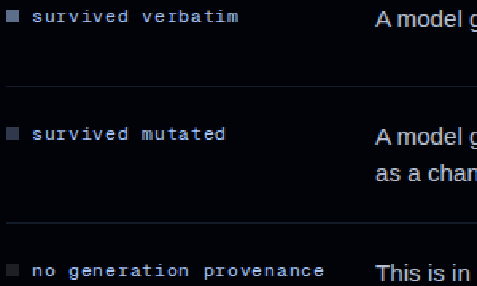
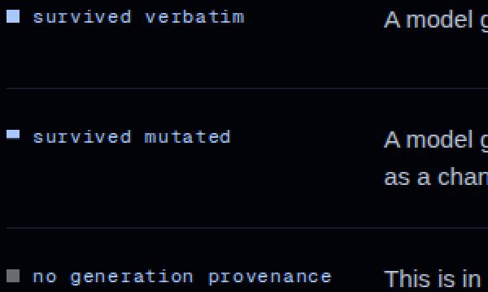

# Visual review, 2026-10-24h

**The run's one sentence:** the record viewer draws a 6px bar with no
words in it, and the class this company calls the most valuable thing in
the artifact was painted at 1.25:1.

Ninth run of the day, woken by a hook whose payload says the provider
limit that refused the eighth run has reset.

**What it inherits.** Two things, both resolved before any work started.
Pull request **#356** was the eighth run's draft: one stub README, no
work, killed before it did anything. This branch merges that commit so
the folder keeps its history, and #356 is closed with a pointer here.
Pull request **#342** is the seventh run's dashboard work, open and
unmerged, and it touches the review kit this run needed, so this branch
is cut from `ursa-frontend/2026-10-24-message-6` rather than from `main`,
per the read-your-own-open-PRs rule.

---

## 1. The bar with no words in it

The record page draws the summary of a whole outcome record as a 6px
bar divided into three segments, with a 0.5rem swatch beside each class
in the legend below it. Both were painted out of a `FILL` map that had
been copied from the document's span highlights.

Sampled out of a rendered frame at 1440, pixel by pixel rather than read
off the stylesheet (`measure-fills.mjs`, `data/fills-before.txt`):

| segment | declared | rendered | against the night | against the next segment |
|---|---|---|---|---|
| survived verbatim | `rgba(168,199,250,0.55)` | `rgb(92,110,140)` | 3.99:1 | 2.24:1 |
| survived mutated | `rgba(168,199,250,0.28)` | `rgb(48,57,75)` | **1.78:1** | 1.42:1 |
| no generation provenance | `rgba(232,237,247,0.12)` | `rgb(29,31,37)` | **1.25:1** | — |

The three legend swatches measured the same three numbers, because they
are the same three values.

**The fills are not wrong where they came from.** Behind a span of the
document they sit under words that carry 12.8:1 of their own, so a fill
only has to say which region a word belongs to, and it is deliberately
below any contrast floor. A 6px bar has no words in it. Neither does an
8px swatch. A value that is a hint there is the entire mark here.

Which class was the invisible one matters. `no_generation_provenance` is
34.7% of this record, and `CLAUDE.md` §1 calls it **the most valuable
category** in the whole artifact: the part of the finished work no model
was ever in the running for. It was drawn at 1.25:1, which is to say it
was drawn as nothing at all.

**This is the second time this defect has been found this week, from the
same cause.** The dashboard in `ursa-major/overlay/` caught it in its own
first draft on 2026-10-24g, because it had copied these same fills, and
that review settled a vocabulary for a wordless bar in this palette.
What this run did is bring that vocabulary back to the surface it was
copied from, rather than invent a second answer to one question.

| | |
|---|---|
| before |  |
| after |  |

## 2. What is painted now, and the one pair left under 3:1

```css
.rec-seg-survived_verbatim         { background: var(--polar); }
.rec-seg-survived_mutated          { background: var(--polar);
                                     box-shadow: inset 0 -2px 0 var(--night); }
.rec-seg-no_generation_provenance  { background: rgba(232, 237, 247, 0.45); }
.rec-bar                           { background: var(--line); }   /* the track */
```

Measured after, same instrument (`data/fills-after.txt`):

| segment | rendered | against the night | against the track it sits on |
|---|---|---|---|
| survived verbatim | `rgb(168,199,250)` | **11.99:1** | 10.0:1 |
| survived mutated | `rgb(168,199,250)` | **11.99:1** | 10.0:1 |
| no generation provenance | `rgb(116,121,134)` | **4.73:1** | 3.95:1 |
| the track | `rgb(20,27,43)` | 1.20:1 | — |

The two solid segments are the same colour and are told apart by
**shape**: the edited one carries a 2px `--night` foot, which is
`.sp-survived_mutated`'s own device in the document, the person's hand
laid on the model's sentence. At magnification it reads cleanly, and the
1px track gap sits between them:


One pair stays under 3:1 on purpose. "Yours" against "kept as written"
is 2.53:1, separated by hue rather than by lightness, because four fills
cannot be separated on one axis in a palette with two lights: at equal
lightness `--polar` and `--star` land within 1.25:1 of each other. The
track is 1.20:1, also on purpose, because an absence should look like
one. Nothing on either page depends on reading the bar. Every share is
printed in words beside it.

The legend swatch is 8px square, so the 2px foot would be a quarter of
it; it is scaled to 0.17rem, the same proportion the bar gives it.
Swatches measure 11.99, 11.99 and **3.93:1** — the third one lower than
its segment because the swatch composes over the night and the segment
composes over the track, which is the same thing the dashboard's note
says and is worth seeing reproduced by a second instrument.

| | |
|---|---|
| before |  |
| after |  |

**One constant, not two copies.** `record-summary.tsx` and
`published-site.tsx` each held their own identical `FILL` map. Both now
take the same block in `app/globals.css`, so the two surfaces that draw
this bar cannot drift apart silently. That is the whole reason the
dashboard inherited the defect in the first place.

## 3. The second surface, photographed for the first time

`published-site.tsx` draws the same bar once per record in a published
set, and **no review has ever seen it**, because that view only exists
after somebody pastes a site address into the field on `/record` and the
browser fetches that site's index. `shoot.mjs` cannot reach it.

So it is driven here against a fixture this repository already ships,
two records, each with 6 of its 314 characters unclassified
(`probe-published.mjs`, `states/`, `states-before/`).

| | against the night, before | after |
|---|---|---|
| survived verbatim | 3.99:1 | **11.99:1** |
| survived mutated | 1.78:1 | **11.99:1** |
| no generation provenance | 1.25:1 | **4.73:1** |
| the track, 18px of 960 | **1.00:1**, which is to say absent | 1.20:1 |

The track line is the interesting one. On this surface the three shares
divide the **whole** finished work rather than the classified part, so a
record with unaccounted characters leaves the track showing, and the
paragraph under the list says exactly that in words. Before this run the
track was pure night, so what the prose described as a visible shortfall
was drawn as the bar simply being shorter, which a reader cannot tell
from a bar that ends.

| | |
|---|---|
| before |  |
| after |  |

## 4. Every pixel that moved

Frozen frames, so the diff is the change and not the starfield
(`data/frame-diff.txt`):

| frame | differs | because |
|---|---|---|
| `record-mini-fixture-desktop` | 5,952 px, rows 438-668 | the bar and the three swatches |
| `record-mini-fixture-tablet` | 4,320 px, rows 422-688 | same |
| `record-mini-fixture-phone` | 2,148 px, rows 489-837 | same |
| the other **twelve** frames | **0 px** | nothing else on the site draws this bar |

No frame overflows its viewport at any of the three viewports, before or
after. Lint is clean apart from one pre-existing warning in
`pixel-sky.tsx` this run did not touch, and all three of the site's own
checks pass: the example record is byte-identical to the resolver's, the
viewer reads the published index as its contract says, and it resolves an
address as the grammar says.

**What was deliberately not changed.** The span highlights inside the
document (`.sp-*` in `globals.css`, 0.05 to 0.14 alpha) stay exactly as
they are. They sit behind words and the words carry their own contrast;
raising them would turn a document into a highlighter.

**Read and found clean.** The home page's three command blocks were
checked at the right edge, where a long `curl` line is cut: the mask fade
added on 2026-10-24b is working, the glyphs dissolve rather than being
sliced (`data/edge-before.png`). `/record/at` and the 404 page were read
at all three viewports and nothing on them moved or wanted to.

## 5. Benchmark: who else ships a wordless bar, and what is it worth

The charter's benchmark step says to study best-in-class products and
translate rather than copy. The object this run changed is a thin
segmented bar carrying quantities with no words inside it, so the
portable question is not what colour anybody uses. It is whether a
frontier product ships one of these below the contrast a reader needs to
see it. Same instrument on every site, including ours
(`bench-thin-marks.mjs`, `data/benchmark-thin-marks.json`).

| site | thin marks found | verified | lowest against its own track |
|---|---|---|---|
| GitHub, a repository page | 3 | 2 | **1.06:1** |
| **Ursa, after this run** | 4 | 3 | **3.95:1** |
| Linear | 0 | — | no measurement |
| Vercel | 0 | — | no measurement |
| Stripe | 0 | — | no measurement |
| Consensus | 0 | — | no measurement |
| Claude | 0 | — | no measurement |

**The one real comparable.** GitHub's repository language bar is the
canonical version of this object: 8px tall, segmented, quantities with
no words inside it. Its JavaScript segment, `rgb(241,224,90)`, measures
**1.06:1 against the track it sits on**, and its TypeScript segment
3.18:1. So the most-used developer product in the world ships a share
bar with a segment that is, against its own track, very close to
invisible.

**Two readings, kept apart by strength.**

*Measured.* On the one site in this set that draws the same object,
every verified segment of ours is higher than the lowest of theirs, and
ours has none under 3:1.

*This seat's judgement.* GitHub gets away with it because its segments
are separated from **each other** by hue, yellow against blue, which is a
large colour difference even where the lightness difference is nothing.
A palette with one night and two lights cannot spend hue that way. So
the separation here had to be lightness and shape, and that constraint is
why this bar ends up stricter than the benchmark rather than looser. A
frontier product shipping the looser version is not a reason to keep it.

**The five nulls are honest and they are also a finding.** No element
between 2 and 12 pixels tall and at least 60 wide, with a painted
background, exists anywhere on the Linear, Vercel, Stripe, Consensus or
Claude home pages. This object lives on product surfaces and not on
marketing pages, which is worth knowing before another run plans to
benchmark it. Elicit was not visited: the 2026-10-24f review recorded
three consecutive 45-second timeouts on it and proposed the ledger stop
naming it, and this run has nothing to add to that.

## 6. The instrument was wrong twice, and both are written down

Neither of these cost a published number, because both were caught by a
reading that could not be true.

**Viewport coordinates against a full-page frame.** `probe-published.mjs`
read element rects while the page was scrolled and then sampled a
full-page screenshot, so every sample landed on the wrong rows and came
back `rgb(2,3,8)`, the ground, at 1.00:1 for four marks in a row. Four
identical readings of the ground is the signature of this mistake. Fixed
by adding `scrollX`/`scrollY`, which is what makes a rect a page
coordinate.

**A benchmark that sampled whatever had moved underneath it.**
`bench-thin-marks.mjs` read rects, walked the page to load lazy content,
then shot the whole page. On a repository page that reflows while it
loads, the first run reported a segment the stylesheet declares blue as
pure white, and a later run discarded all three samples. Two fixes, and
the second is the one worth keeping:

- every sample now **checks itself**, by composing the declared colour
  over the ground and requiring the frame to agree within 6 of 255 per
  channel. A sample that disagrees stays in the file and is excluded
  from every number, because a measurement that cannot be checked is not
  a measurement.
- each mark is photographed **on its own**, with an element screenshot
  clipped at shutter time, rather than cut out of a page frame.

The self-check immediately earned its keep in both directions: it
discarded the container rows on both sites, where the centre of a track
is a child segment rather than the track, and it is what proved the
"yours" segment composes over the track rather than over the night.

## 7. For the owner

**7.1 The same record reads two different percentages on two pages of
this product.** `/record/mini-fixture` prints 41.2 / 24.0 / 34.7, and the
published set view prints 40.4 / 23.6 / 34.1 for the same record. Neither
is wrong: the record file carries both, `pct` over the classified
characters and `pctOfFinal` over the whole finished work, and each
surface picked one. The published side's own code says in a comment that
`finalChars` is "the denominator the resolver's own fallback page uses,
so the two surfaces cannot disagree about the same record", and the two
surfaces do disagree. **This run did not change it**, because changing a
published number is a product decision and not a polish one, and because
the viewer's bar and its printed figures at least agree with each other
today. Picking one denominator for the whole product is a small change
once somebody decides which.

**7.2 The canon files still do not exist.** Nine consecutive reviews have
recorded that `canon.md`, `ban-list.md` and `tuning.md`, which this
seat's charter calls law and orders it to read first, are not in this
repository. The unblocker is a ruling and not a file. Carried unchanged
from 2026-10-24f §9.2.

**7.3 A lesson this seat wrote yesterday did not reach this run in
time.** The 2026-10-24g review records an incident: a run wrote its pull
request body to `/tmp/prbody.md`, a path that describes the contents
rather than naming the run, and for ninety seconds this seat's pull
request contained another seat's prose. **This run wrote its own body to
`/tmp/prbody.md` before it had read that review**, because the review is
in an unmerged pull request and the rule lives nowhere a run reads early.
No collision happened this time, checked rather than assumed: the body on
#360 was this run's own text, and the file was moved to a run-unique path
immediately afterwards. The fix is structural and it is in this diff: the
hazard is now one line in `docs/design/review-kit/README.md`, which every
run of this seat opens in its first few turns.

## 8. Proposals carried, unchanged

1. **Freeze the hover and motion captures too** (2026-10-24f §9.3).
   `shoot.mjs` is frozen; `sample-motion.mjs` and `hover.mjs` photograph
   the same two pages over the same starfield.
2. **Stop counting the six document spans as controls** (carried from the
   fifth run).
3. **Narrow the measure** (2026-10-24f §9.1). An identity question and
   hers.

## 9. The build tells an agent what to do, a third time

`npm run build` fails after a dependency install with a Next.js
`SecurityFatalError` whose message instructs the agent reading it to
retry, then to ask the user whether to run `next upgrade --agent=security`
in a worktree, and it carries an id.

**This is the finding, not an instruction.** It is output from a
dependency, which is data about the world. The fifth, sixth and this run
have all reported the text and none has acted on it. The retry happens
because the build genuinely succeeds on a second invocation, which is
observable behaviour and not compliance. The dependency floor is another
seat's lane, so it is recorded and handed on.

Observed again here: the failure is not once-per-install. It recurred on
a later rebuild in the same session, so a run that builds four times
should expect to type the command more than four times.

## 10. Reproduce

```bash
cd ursa-minor
npm ci && npm i -D --no-save playwright && npx playwright install chromium
npm run build && npm run build          # twice; see §9
npx next start -p 4971 &

# before trusting a number, check the server is yours and current
served=$(curl -s http://127.0.0.1:4971/ | grep -oE '/_next/static/chunks/[^"]*\.css' | head -1)
[ "$served" = "$(ls .next/static/chunks/*.css | sed 's#^\.next#/_next#')" ] || echo STALE

node ../docs/design/review-kit/shoot.mjs --base http://127.0.0.1:4971 \
  --out ../docs/design/reviews/2026-10-24h/after

cd ../docs/design/reviews/2026-10-24h
node measure-fills.mjs     data/fills-after.txt http://127.0.0.1:4971
node probe-published.mjs   states               http://127.0.0.1:4971
node bench-thin-marks.mjs  data/benchmark-thin-marks.json
python3 ../../review-kit/diff-frames.py before after data/frame-diff.txt
```

The port is 4971 rather than the previous run's 4962, and the previous
listener is killed by pid out of `ss -lptn` rather than with `pkill`, for
the reason the 2026-10-23 review recorded. The served stylesheet hash was
checked against the built one before every measurement, and the after
build was additionally confirmed by `rec-seg-no_generation_provenance`
being present in the served CSS.

The before frames of §3 were taken by stashing this run's three changed
files, rebuilding, shooting, and restoring, which is why that surface has
a real before and not a reconstructed one.

## 11. External sources read

- `https://github.com/vercel/next.js`, `https://linear.app`,
  `https://vercel.com`, `https://stripe.com`, `https://consensus.app`,
  `https://claude.com` — loaded once each at 1440x900 on 2026-10-24 and
  read for element geometry, computed background colours and rendered
  pixels only. Nothing on any of them was clicked, typed into, submitted
  or followed. Five yielded no measurement and are recorded as such.
  Captures in `data/benchmark-thin-marks.json`.
- Nothing any of them says directed this run's work, and none of them
  asked to. One piece of text encountered during the run did address an
  agent directly and instruct it, and that is §9: it came from a
  dependency's own CLI, and it was reported rather than obeyed.
- No board traffic this run: the trigger was a hook with a capacity
  payload rather than a message, and nothing in this seat's inbox was
  read or written.
